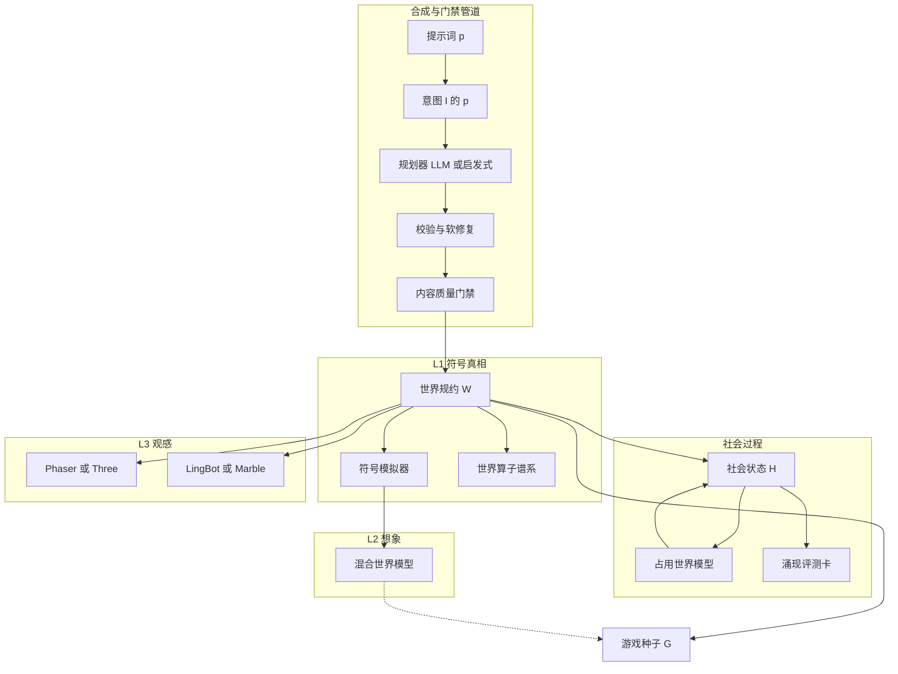

# 第3章 问题形式化与总体架构

## 3.1 大白话导读：先把「世界」说成能写进公式的东西

日常语言里，「世界」什么都装得下：地图、人、天气、剧情、画面、服务器。公式受不了这种含糊。本章做一件小事：规定本文里每一个词指什么，以及它们之间谁听谁的。

仍然用城市类比。地籍图是规约。改建许可证是世界算子。交通仿真是符号模拟器。居委会巡查是社会心跳。气象雷达是占用世界模型。旅游宣传片是 L3。游戏光盘是编译产物。谁也不能用宣传片去改地籍。

## 3.2 基本对象

**定义 3.1（世界规约）。** 一个世界规约 \(W\) 是七元组

\[
W = (\mathcal{M}, \mathcal{S}, \mathcal{E}, \mathcal{R}, \mathcal{U}, \mathcal{N}, \Pi)
\]

其中 \(\mathcal{M}\) 是元信息（标识、标题、版本），\(\mathcal{S}\) 是空间（区域、传送门、起始区域），\(\mathcal{E}\) 是实体集合，\(\mathcal{R}\) 是关系集合，\(\mathcal{U}\) 是规则集合，\(\mathcal{N}\) 是叙事（标志位、任务、节拍），\(\Pi\) 是呈现提示（引擎模式、体裁包、空间后端、叙事种子等）。时间标量 \(t\) 以小时计，可写在 \(W\) 上。

这不是为了好看。每一项都对应 Zod 模式里的一段。缺区域的世界无法走；缺实体的世界无法看；缺呈现提示的世界仍可能被模拟，但不能被正确编译。

**定义 3.2（意图中间表示）。** 对提示词 \(p\)，意图中间表示

\[
I(p) = (\gamma, P, O, n, \kappa, F)
\]

其中 \(\gamma\) 是体裁包标识（小镇 / 船员 / 修道院），\(P\) 是地点承诺，\(O\) 是职业承诺，\(n\) 是可选人口提示，\(\kappa\) 表示是否请求经典斯坦福小镇，\(F\) 是禁止使用的区域标识集合。

**定义 3.3（承诺满足）。** \(W\) 满足 \(I(p)\)，记 \(W \models I(p)\)，当且仅当：体裁一致；每个地点承诺被某个区域或子区域名称覆盖；每个职业承诺出现在至少一个居民身份上；人口不低于门禁下界（或不超过用户明示的人数）；若 \(\kappa\) 为假，则 \(W\) 的区域标识与 \(F\) 不相交。

「覆盖」允许宽松匹配：用户说「舰桥」，生成「主舰桥」可以通过；生成「城镇广场」不能通过。第 5 章给出实现层的宽松规则。

**定义 3.4（世界算子）。** 世界算子 \(\omega\) 是对 \(W\) 的一次类型化突变，产生

\[
\mathrm{Apply}(W,\omega) = (ok, W', \Delta)
\]

\(ok\) 为假时 \(W\) 不变。\(\Delta\) 包含脏资产键，告诉后续管线哪些图要重画。合法算子包括增删改区域与实体、置标志、改布局、合并世界、改体裁与时钟等。算子序列构成修订谱系。

**定义 3.5（符号步进）。** 符号模拟器 \(\mathrm{Sim}\) 在给定效果或时间推进下产生事件集合。规则是「条件 → 效果」对。条件构成与/或/非代数。效果改标志、属性、背包、位置、任务状态或时间。同一 \(W\) 与同一输入下，\(\mathrm{Sim}\) 确定性。

**定义 3.6（社会状态）。** 社会状态 \(H\) 包含模拟时、居民姿态、物体状态、日计划、记忆流、关系、事件、可选占用模型内部统计。它由 \(W\) 水合而来：没有规约里的人，就不会凭空出现社会里的人。

**定义 3.7（社会步进）。** \(\mathrm{Step}(H;\theta)\) 把社会推进 \(\Delta t\) 小时。参数 \(\theta\) 包含大模型预算、对话上限、随机种子等。步进可包含：占用预测与惊讶、需求增长、计划、感知与反应、寻路、使用物体、对话、记忆刷新与反思。

**定义 3.8（涌现评测卡）。** 给定轨迹 \(\tau\) 与种子文本 \(s\)，评测卡至少包含信息扩散率、关系数量与平均亲密度、社交窗口内的峰值共址率、日程路线多样性、对话新颖度。体裁包给出窗口长度与扩散下界。门禁失败定义为：窗口已到且扩散率仍低于下界，或多样性/新颖度低于实现给定阈值。

**定义 3.9（编译）。** \(\mathrm{Compile}(W)\) 产生游戏种子 \(G\)。要求确定性：\(\mathrm{Compile}(W)=\mathrm{Compile}(W)\)。\(G\) 可被运行时加载为可玩场景。玩法权威仍在 \(W\)：编译器不得发明规约中不存在的获胜条件，除非处于明确的角色扮演填充模式，且必须可被门禁看见。

**定义 3.10（混合想象）。** L2 模型 \(f_\phi\) 把编码后的状态与动作映到下一状态向量。惊讶是预测与符号真实下一状态之间的距离。难度提案是惊讶、置信与战斗压力的函数。若未加载权重，提案为空，编译器使用默认旋钮。

## 3.3 总问题

给定 \(p\) 与计算预算 \(B\)，求解

\[
(W,H_0,G) \quad \text{s.t.}\quad \mathrm{Valid}(W),\ W\models I(p),\ G=\mathrm{Compile}(W)
\]

并在预算内产生轨迹 \(\tau=\mathrm{Step}^{k}(H_0)\)，使 \(\mathcal{E}(\tau)\) 尽可能满足体裁门禁。这不是一个有闭式解的优化题。它是一个带硬约束的生成–校验–模拟问题。硬约束优先于「更好看」。

我们把预算 \(B\) 显式写出来，是因为没有预算的生成式社会不是系统，是账单。\(B\) 分解为：规划用的推理调用、社会对话调用、计划/反思调用、图像与视频调用。任何一层耗尽，必须降级到启发式或模板，而不是返回一个假装成功的空世界。

## 3.4 三层架构与一条管道

图中虚线表示「建议」，实线表示「权威」。L2 可以建议敌人血量，L1 决定敌人是否存在。L3 可以建议镜头，L1 决定区域是否存在。

有两个时钟，必须写清，否则后文全乱。

**规约时钟** \(t_W\)：符号模拟器和任务规则使用，单位小时，可由效果推进。

**社会时钟** \(t_H\)：生成式居民使用，默认步长约 0.25 小时。平台心跳按这个钟走。

它们可以对齐（社会从规约水合时拷贝），但不是同一个变量。观察者模式里，用户看到的回放沿着 \(t_H\)。角色扮演模式里，玩家输入转换成对 \(W\) 的效果，再反映到呈现。把两个钟混成一个「tick」，是集成时最常见的缺陷。

## 3.5 体裁包作为制度先验

同一套社会内核不能假设全世界都有傍晚广场。体裁包 \(\Gamma\) 提供：

- 时钟种类：日周期、值班班次、事件节拍；
- 人口区间；
- 拓扑区间（最少/最多区域）；
- 允许的干预动词（耳语、改物体、主持集会）；
- 枢纽类型（广场、舰桥、食堂）；
- 涌现阈值。

内核负责走、说、用、记。包负责「什么叫一天」和「什么叫凑在一起」。这是软件工程里策略与机制分离，也是对生成式智能体工作的必要推广：Smallville 只是 \(\Gamma\) 的一个取值。

## 3.6 威胁模型（失败的三种样子）

形式化如果不能指出失败，就只是记号。

**幻觉。** \(W \not\models I(p)\)。表现：用户要休眠舱，得到客栈巷；用户要八人，得到两个招牌 NPC；用户禁止陆地小镇，得到 `town_square`。对策：意图抽出、禁止标识集合、质量门禁、深度填充时也不准使用禁名。

**不可玩。** \(\mathrm{Valid}(W)\) 为真，但 \(\mathrm{Compile}(W)\) 无法在浏览器给出可达的观察或操作循环。表现：区域不连通、没有可行走单元格、社会回放事件为空、L3 槽位是 1×1 占位图却声称可播。对策：ASCII 布局语法、可玩性探针、L3 槽位检查、构建失败进入修复环。

**塌模板。** 不同的 \(p\) 映射到同一组脚手架标识和同一套取矿任务。表现：货船、修道院、赛博夜市最终都叫城镇广场，铁匠都在等铁矿。对策：经典小镇需要显式触发；默认社会优先而非战斗循环优先；叙事种子区分观察与通关。

这三种威胁会组合。最常见的组合是幻觉加塌模板：模型不会写货船，于是返回它训练时最熟的镇。门禁必须把这种返回当成失败，而不是当成「至少能玩」。

## 3.7 设计不变量（实现时不许破的句子）

不变量 1：任何神经网络或视频后端的输出，在未经过 WorldOp 或规则效果之前，不得改变任务状态、背包和标志位。

不变量 2：社会对话可以失败、可以降级，但降级路径仍须尝试扩散高重要性记忆。

不变量 3：编辑世界必须产生新的修订版本，而不是原地暗改后无法回滚。

不变量 4：资产生成不得早于内容门禁。先有合格的 \(W\)，再画画。

不变量 5：飞行员与导演可以提议算子，算子仍须通过 \(\mathrm{Apply}\) 的校验。

这些句子在第 8 章会变成流水线顺序。它们在本章出现，是为了让后文每引入一个模块都知道自己站在哪一层。

## 3.8 与代码包的一一对应

| 符号 | 包或文件 |
|------|-----------|
| \(W\) | `@opengame/world-spec` |
| \(I(p)\) | `world-planner/src/intent.ts` |
| \(\mathrm{Apply}\) | `@opengame/world-ops` |
| \(\mathrm{Sim}\) | `@opengame/world-sim` |
| \(H,\mathrm{Step}\) | `@opengame/world-agents` |
| \(f_\phi\) | `@opengame/world-neural` |
| \(\mathrm{Compile}\) | `world-spec/src/toGameSeed.ts` |
| 呈现与 L3 | `@opengame/world-runtime` |
| 管道 | `apps/platform-worker/src/worldPipeline.ts` |

后文引用模块时，默认就是这些包。我们不再每次重复路径。

## 3.9 一个走到底的玩具例子（形式化不离开地面）

设 \(p=\)「运河货船，八名船员，要有舰桥和休眠舱，观察他们值班，不要广场」。

则 \(I(p)\) 中 \(\gamma=\)船员，\(P\) 至少含舰桥与休眠舱，\(n=8\)，\(\kappa=\)假，\(F\) 含 `town_square` 等。任何含 `town_square` 的 \(W\) 都有 \(W\not\models I(p)\)。任何只有两名船员的 \(W\) 在人口门禁上失败。任何把枢纽文案写成「晚会广场」的 \(W\) 在制度一致性上失败——这一项可以放在文案检查或体裁包检查里，它说明满足结构承诺仍可能不满足制度承诺。

合法的 \(W\) 将有约四以内的区域、八名带值班职业的实体、班次时钟、舰桥枢纽。社会初始状态 \(H_0\) 从这些实体水合。\(\mathrm{Compile}(W)\) 给出可走的船舱场景，玩法清单以观察为主。L2 提案为空或被跳过。L3 可缺席。

这个例子在后文反复出现。每当算法变得抽象，就把它代入：这一步会不会把船变回镇？会不会让八个人变成二十五？会不会让视频决定交班是否完成？

## 3.10 复杂度与失败点（非正式）

结构校验与算子应用相对规约大小近似线性。社会每步相对居民数、感知半径内邻居数、寻路网格大小增长。对话若每对都调用模型，则是居民数平方级的账单爆炸，这正是对话上限存在的原因。占用向量固定八维，计算可忽略。编译相对实体数线性。

真正的失败点很少是渐近复杂度，而是：模型延迟导致定住超时；网格过大导致寻路卡顿；事件日志无限增长导致回放变慢；嵌入升级把数据库写满。这些是系统问题，应在实现上截断历史、折嵌入、租约停止空闲心跳。论文把它们记下，以免有人以为形式化已经保证实时。

## 3.11 小结

本章把「生成一个会过日子的可玩世界」写成：在预算下寻找满足承诺的规约，编译成游戏，并在规约上跑社会步进直到涌现门禁可判定。三层模型规定了想象和观感的权限。两种时钟规定了任务规则和居民生活不要抢同一个计数器。下一章打开规约本身，看账本的每一栏怎么记。
