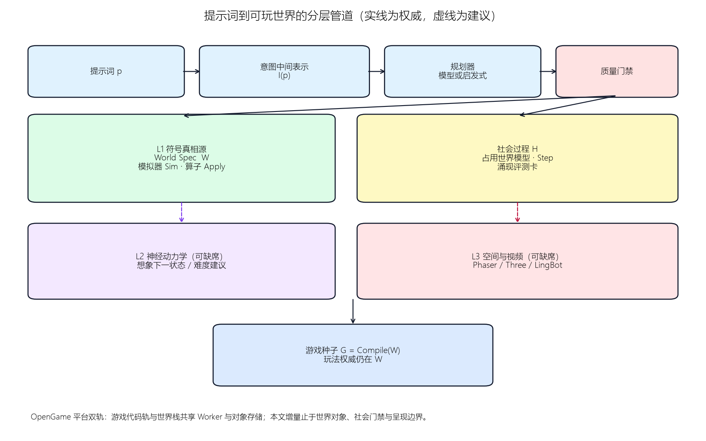
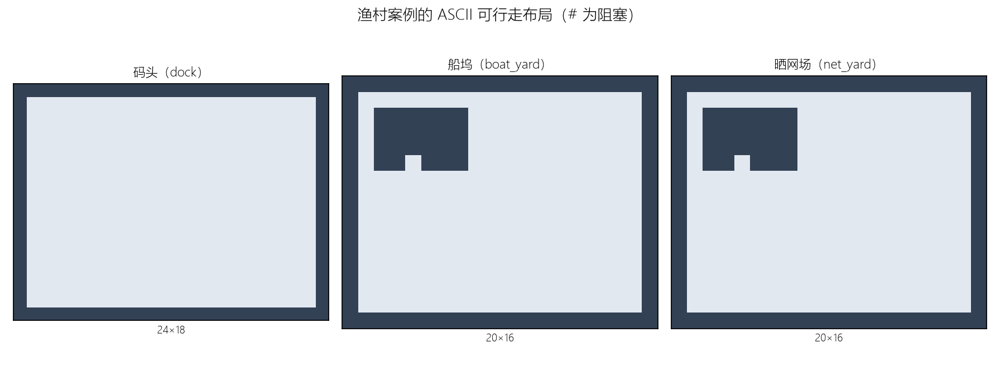
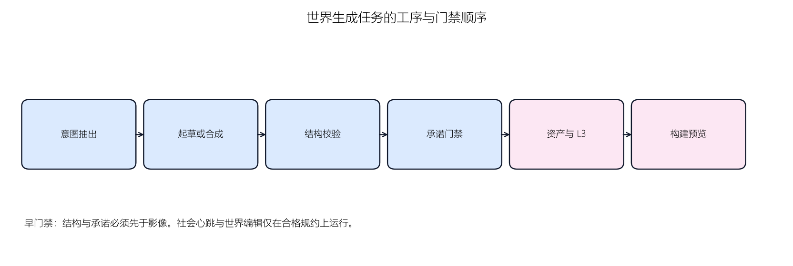
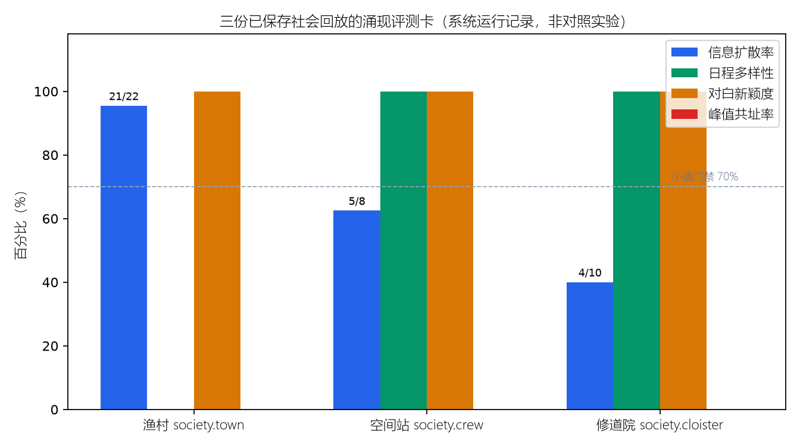
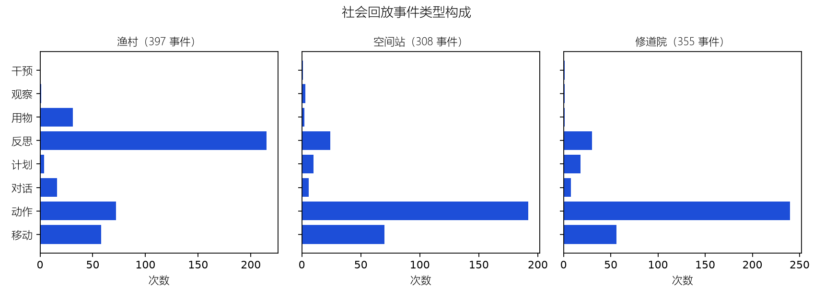
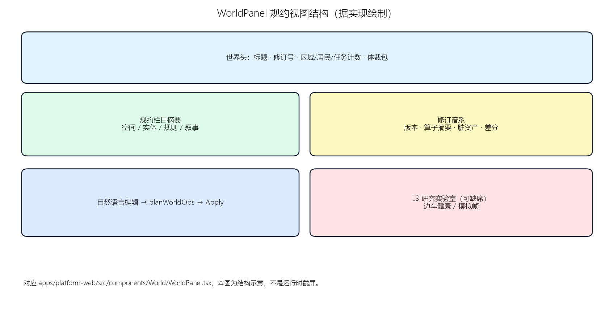
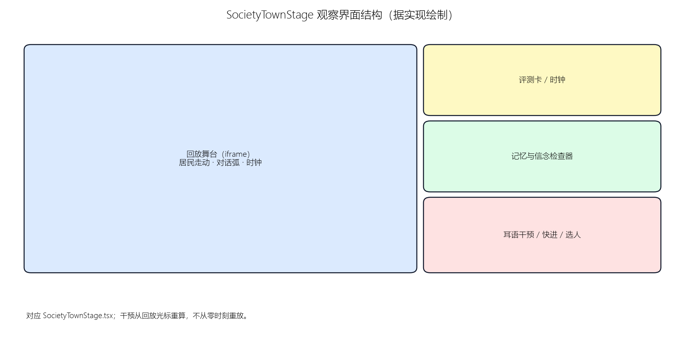
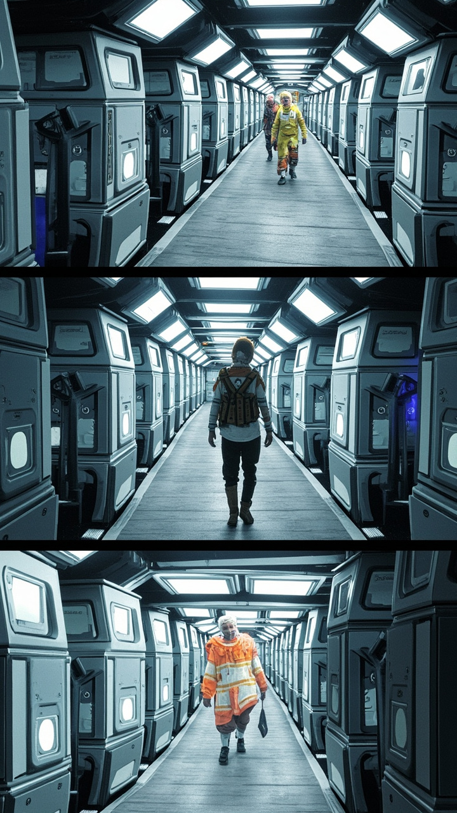

# 面向可玩交互的混合世界模型：符号世界规约、在线社会动力学与涌现门禁

**学科：** 计算机科学与技术 / 人工智能 / 数字游戏

**论文类型：** 博士学位论文（中文）

**实现载体：** OpenGame 平台世界栈（World Spec / Society Kernel / Hybrid L1–L3）

---

## 中文摘要

从一句自然语言同时得到「可核对、可修订、可观察过日子」的交互世界，现有路径彼此难以衔接。程序内容生成擅长多样的空间与规则，却很少把用户句子中的专有承诺当作硬约束。交互视频与潜空间世界模型擅长预测下一帧或下一潜状态，却默认不拥有背包、任务状态机与确定性回放。生成式智能体（Park 等，2023）证明居民可以在沙盒中形成记忆、计划与信息扩散，但其舞台通常由作者预先布置，并不能由用户提示编译出新的地理与制度，也难以把同一份世界确定性编译为可玩的游戏。游戏代码智能体可以把提示词变成能运行的网页项目，优化目标是构建健康与可玩性，而非把世界本身做成可差分、可门禁的对象。

本文研究如何在计算预算约束下，从单条提示词得到三件必须互相约束的产物：（1）满足意图承诺且通过结构校验的符号世界规约；（2）在该规约上推进、并以涌现指标作为可失败检查的社会生活轨迹；（3）由规约确定性编译、玩法权威仍在规约一侧的可运行呈现。方法上，世界规约（World Spec）作为单一真相源（L1）：空间、实体、关系、规则与叙事受类型系统约束，由确定性模拟器求值，由世界算子（WorldOp）修订并保留谱系。自然语言先编译为意图中间表示（体裁、地点、职业、人口、禁名），再经大模型起草或启发式合成；非经典提示禁止塌回斯坦福小镇脚手架标识。社会内核与体裁包解耦，在生成式智能体认知循环之上增加需求打断、预算化对话，以及心跳内的占用世界模型：指数滑动平均预测人群分布，残差（惊讶）抬高好奇心并产生可观察的调查行为。神经动力学（L2）与空间/视频后端（L3）只负责想象与观感，不得改写任务、战斗与背包。

本文贡献有四。第一，给出规约数据模型、条件—效果代数、确定性模拟与 WorldOp 修订语义，使游戏成为编译皮肤而非真相源。第二，给出承诺约束合成，使人话中的地点、职业、人口与体裁成为对生成器可行使的否决权。第三，把在线占用预测耦合进社会心跳，使世界模型误差进入行为驱动，并以涌现评测卡作为回归门禁。第四，给出 L1/L2/L3 权限边界与从规约到预览的质量流水线。证据来自开源实现、自动化测试，以及渔村、空间站、修道院三份已保存的世界规约与社会回放；消融对照与人类评测列为未来工作，本文不将其写为已完成结论。

**关键词：** 混合世界模型；世界规约；生成式智能体；程序内容生成；神经符号系统；涌现评测；游戏人工智能

---

## Abstract

Generating an interactive world that is simultaneously checkable, revisable, and socially alive from a single prompt currently splits into conflicting routes. Procedural content generation diversifies maps and rules but rarely treats named commitments in the user’s sentence as hard constraints. Interactive video and latent world models predict the next frame or latent but do not own inventory, quests, or deterministic replay. Generative agents (Park et al., 2023) socialize with memory and plans on a stage that was typically authored, not compiled from the prompt, and are rarely compiled into a playable game whose rules remain inspectable. Game-coding agents deliver playable web projects; they optimize build health, not a world object with lineage.

This dissertation asks how to obtain, under a compute budget, a typed World Spec as single source of truth (L1), a gated living-society trajectory on that spec, and a deterministic compilation whose gameplay authority stays on the spec. Natural language is compiled into an Intent IR; custom prompts are forbidden from collapsing onto a Stanford-town scaffold. A pack-agnostic society kernel steps the spec with needs, budgeted dialogue, and an in-tick occupancy world model whose prediction residual raises curiosity. Neural dynamics (L2) and spatial/video backends (L3) may be absent; they never rewrite quests, combat, or inventory.

Four systems contributions follow: spec-as-SSOT with WorldOp lineage; promise-constrained synthesis; occupancy-coupled society with emergence gates; and a hybrid pipeline that compiles a world into a playable presentation. Evidence is the open implementation, regression tests, and three saved worlds with society replays. Ablations and human-subject scores remain future work.

**Keywords:** hybrid world models; world specification; generative agents; procedural content generation; neuro-symbolic systems; emergence evaluation; game AI

---

## 目录

- 中英文摘要
- 第1章 绪论
- 第2章 相关工作与研究定位
- 第3章 问题形式化与总体架构
- 第4章 世界规约与世界算子
- 第5章 意图中间表示与承诺约束合成
- 第6章 社会内核与在线占用世界模型
- 第7章 混合呈现边界
- 第8章 编译流水线与质量门禁
- 第9章 系统验证与案例
- 第10章 结论与展望
- 参考文献
- 附录 A–G、L、N

---

# 面向非本领域读者的阅读导引

本节不提出新的技术贡献，而是建立理解后文的最低共同背景。本文讨论的“世界”不是一张静态地图，也不等同于一段视频或一份游戏源代码。它是一个能被程序检查的对象：其中明确写出有哪些地点、哪些角色、角色能做什么、条件满足后哪些状态会变化，以及时间如何推进。读者可先把它理解成一个“可执行的世界说明书”。说明书能被软件读懂，软件据此生成画面、安排居民活动，并在修改后保留修改记录。

为避免术语在首次出现时造成理解负担，本文把问题分为四个层面。

第一是**世界内容层**：用户说“我想要一艘有舰桥和休眠舱的货船”，系统需要知道舰桥、休眠舱、船员、班次等对象是否真的出现。第二是**世界规则层**：例如“拿到钥匙才能开门”“交班发生在特定时段”。规则必须能反复执行、能从日志重放，不能依赖某一次模型临场发挥。第三是**社会过程层**：居民并非只站在地图上，他们有记忆、计划、需要与交流；时间推进后，观察者可以追问消息是否传播、谁在哪里相遇。第四是**呈现层**：二维游戏、三维场景或视频只是将前述世界显示给人看的方式。本文的关键立场是：画面可以更换，世界事实不能随画面自行变化。

“单一真相源”（single source of truth, SSOT）是贯穿全文的工程原则。假设某任务已完成：若游戏场景 A 显示任务完成，而存档、居民记忆和场景 B 都没有该状态，那么玩家看到的成功无法被重放或验证。相反，若任务状态只保存在同一份规约中，场景、存档、任务日志均从它读取，显示方式不同也不会改变事实。本文将这种权威事实集合称为 L1。L2 是帮助预测或提出建议的神经模型；L3 是帮助显示和生成空间媒体的后端。L2、L3 可以不在场，L1 不可以。

“生成”在本文中也有严格含义。它不是模型写出一段看似合理的文字，而是从提示词形成一个经过检查的世界对象。例如提示词要求“八名船员”和“不要城镇广场”，系统应当能逐项回答：船员数是否为八，区域是否含舰桥和休眠舱，是否出现禁止的脚手架标识。若不能回答，结果至多是灵感草稿，不是合格世界。第5章把这种逐项核对称为承诺约束；第8章把自动拒绝不合格结果的步骤称为门禁。

“涌现”同样不等于“看起来热闹”。本研究将其限定为可从回放日志计算的群体结果。例如一条种子消息在规定时段内被多少居民知晓，多少居民在同一时段同一区域共址，不同职业的居民是否走出不同路线，对话是否只是重复。第9章报告这些记录时，将其标为案例运行记录，而非人与人之间的统计优劣比较。读者若只关心系统能否运行，可先看第3、8、9章；若关心世界如何被写成可修改对象，可读第4、5章；若关心居民如何推进日常生活，可读第6章。

# 第1章 绪论
# 第1章 绪论

## 1.1 研究背景与问题提出

数字游戏世界长期处在手工设计与程序生成两端。手工世界可信、可测，但难以按一句自然语言定制；程序内容生成（Procedural Content Generation, PCG）降低了内容成本，却很少把「用户这句话里的专有地点、职业与人数」写成可判定的合同。大语言模型出现之后，三种能力同时变得廉价：直接写游戏代码、扮演非玩家角色说话、按概念生成过场或交互视频。它们并未自动长成同一种能力。一段能编译的脚本不等于一份可校验的世界；一段好看的漫游视频不等于背包与任务的可复现因果；一群会说话的智能体若站在错误的地理上，仍然不是用户要的那个世界。

工业与平台约束使问题从演示推进为系统：世界须能在浏览器中运行；须能多轮修订而不推倒重来；须能在模型额度耗尽时降级而不是假死；须能把失败写入日志，而不是用另一次随机生成掩盖。于是「世界生成」不再只是内容多样性问题，而是表示、权限与评测如何互相约束的问题。

能力碎片已经齐备，合成它们的纪律却往往缺席。没有纪律时，最容易发表的是演示，最容易腐烂的也是演示：密钥耗尽则社会假死；提示词一变即回到广场脚手架；视频一挂则游戏停摆；编辑一次便无法回放。开源实现被迫面对这些腐烂形式，由此产生的门禁、降级与禁名装置，构成可以写成方法的对象。

考虑提示词：「运河货船，须有舰桥与休眠舱，八到十名船员按班值班，不要生成名为城镇广场的陆地小镇。」该句同时约束空间、人口、时间制度、观察型玩法，以及禁止塌回熟悉模板。代码生成路径容易写出互不一致的场景文件；视频路径无法回答「交班改到货舱」是否在十二小时内传开；生成式智能体路径默认舞台已在。本文把问题表述为：如何从单条提示词同时得到可核对的世界对象、可门禁的社会生活，以及可缺席而不毁掉世界的游戏呈现。

## 1.2 研究对象与 OpenGame 双轨关系

OpenGame 平台存在两条生成轨道，共享工作进程、对象存储与控制台，**不共享第一创新点**。

- **游戏代码轨**（已发表工作，Jiang 等，arXiv:2604.18394）：提示词 → 可玩网页游戏。评测侧重构建健康、视觉可用与意图对齐。
- **世界栈**（本文）：提示词 → 符号世界规约 → 社会模拟 → 可选神经/视频层 → 编译为呈现。评测侧重承诺兑现、谱系可回放、日子可门禁、皮肤可缺席。

后文所称「系统」均指世界栈。游戏轨仅作为平台背景出现，其基准成绩不计入本文结论。实现落在 `packages/world-*` 与 `apps/platform-worker/src/worldPipeline.ts`。读者无需事先熟悉该仓库：第3章给出符号与模块对应，第9章给出可复现路径。

控制台中的检索增强生成（RAG）与项目简报属于代码智能体侧的上下文工程；社会记忆流属于世界侧的认知架构。二者都可称为 memory，但不是同一模块。游戏生成走 PLAN–ASSET–CODE–BUILD–QA–FIX；世界生成走规划—校验—门禁—脚手架—社会心跳。把世界提示丢进游戏轨，会得到能玩但不可修订的项目；把「做贪吃蛇」丢进世界合成器，会得到形态错位的小镇。世界轨道必须显式进入。后文只引用这一关系，不再反复辩论「邻居 / 吞并」。

## 1.3 研究问题与威胁模型

记提示词为 \(p\)。本文求解：

1. 世界规约 \(W\)，满足从 \(p\) 抽出的意图 \(I(p)\)，且 \(\mathrm{Valid}(W)=\mathrm{true}\)；
2. 社会轨迹 \(\tau\)，使涌现评测卡 \(\mathcal{E}(\tau)\) 在体裁窗口内可判定；
3. 呈现 \(G=\mathrm{Compile}(W)\)，玩法状态由 \(W\) 解释，而非由视频帧解释。

三者必须互相约束。\(W\) 过宽则 \(G\) 不可玩；\(G\) 过自由则 \(W\) 失去权威；社会若无视 \(W\) 的空间与职业，承诺兑现为假。失败模式显式分为三类：

- **幻觉：** 生成用户未请求的地理或制度，或未覆盖用户请求的地点与职业。
- **不可玩：** 结构看起来完整，但编译后空间不可达、无稳定时间推进，或占位图冒充可播媒体。
- **塌模板：** 不同提示映射到同一组斯坦福小镇标识（如 `town_square`、`home_row`）和同一套取矿打狼任务。

对应可证伪问题为：关闭禁名后脚手架标识是否回潮（Q1）；关闭占用惊讶后调查类事件计数是否不变（Q2）；关闭 L3 后面任务标志是否仍不变（Q3）。第9章仅部分回答 Q1（回归用例，尚无冻结题集通过率）；Q2、Q3 的对照实验列为待补。

方法学上，本文属于设计科学与系统研究：提出构念（规约、算子、意图、占用惊讶、门禁）并在可运行系统中实例化，用测试把失败模式分开。管道含启发式与模型，不具端到端形式证明。评价标准是失败能否分科定位，而非单一排行榜分数。若系统仍只能用「再生成一次」应付一切失败，则构念尚未完成。

## 1.4 方法概要与主要贡献

总体思路是分层混合结构：符号规约承担账本，社会内核承担日子，神经层承担想象，空间层承担观感，编译器承担皮肤。质量门禁在资产生成之前拒绝空世界与塌模板；涌现门禁在社会快跑之后拒绝「看起来热闹、实际未传播」的假活。L2 与 L3 允许缺席。

贡献与所挡失败如下（表 1-1）。Park 的记忆检索公式、A\*、普通多层感知机本身、LingBot 权重均不申报为本文发明。

**表 1-1 贡献、失败与证据边界**

| 编号 | 贡献 | 挡住的失败 | 不是本文发明 | 目前证据 | 待补 |
|------|------|------------|--------------|----------|------|
| C1 | 规约 SSOT + WorldOp 谱系 | 暗改、不可回放、场景私藏胜负 | Zod、一般 JSON | 校验与编译确定性测试 | 更大角色扮演可玩探针 |
| C2 | 承诺约束合成 | 脚手架塌缩、人数灌水、制度串味 | 正则抽出本身 | 渔村/空间站/否定广场等用例 | 冻结题集通过率 |
| C3 | 心跳内占用惊讶 + 涌现闸门 | 预测不在场、没钱假死 | Park 检索公式 | 预算耗尽仍交谈；短测扩散；闸门函数；三份回放评测卡 | 关掉惊讶的消融 |
| C4 | L1 不可替换 + 编译门禁 | 视频改账本、占位图冒充可播 | LingBot 权重、MLP 容量 | L3 探测；难度旋钮可缺席 | 关闭边车的形式化实验 |

C4 表述与证据强度对齐：本文证明接口与权限，不证明已训出可替代符号模拟器的基础模型。标题中的「混合」指 L1 权威下的可插拔 L2/L3，而非端到端视频世界。

## 1.5 论文结构

第2章综述 PCG、世界模型、生成式智能体、神经符号方法、游戏 DSL 与代码智能体，并固定本文接法。第3章给出符号、三层架构、双时钟与不变量。第4–6章分别展开规约与算子、承诺合成、社会内核与占用模型，构成方法主体。第7章讨论 L2/L3 权限，措辞克制。第8章给出流水线与门禁顺序。第9章报告实现正确性、三份真实案例与自动化测试，并列待补实验。第10章总结局限与未来工作。参考文献与算法、术语、失败模式等见文末附录。

# 第2章 相关工作与研究定位

## 2.1 对照总表

相关工作按问题组织。表 2-1 给出接法，避免把既有里程碑写成新桥。

**表 2-1 本文与主要相关方向**

| 方向 | 擅长 | 通常不保证 | 本文接法 |
|------|------|------------|----------|
| 程序内容生成 | 多样地图、规则、关卡 | 用户句子被当作合同 | 承诺约束 + 质量门禁 |
| 潜空间/视频世界模型 | 预测下一观感或帧 | 背包与任务的可复现因果 | L2/L3 不得改 L1 |
| 生成式智能体 | 记忆、计划、信息扩散 | 世界从提示词新长出来 | 内核接到 Spec，并加在线占用模型 |
| 游戏 DSL / 运行时 | 稳定玩法骨架 | 过日子的社会 | 规约编译成种子，社会另走心跳 |
| 游戏代码智能体 | 提示词到能跑的游戏 | 世界作为可修订对象 | 平台双轨，非本文主贡献 |
| 规则多智能体仿真 | 可分析、可重复 | 自然语言定制制度后规则从哪来 | 体裁包 + 合成 + 门禁 |

## 2.2 程序内容生成与学习式内容

Togelius 等将 PCG 描述为算法生成游戏内容，并区分在线/离线、必要/可选、确定性/随机等维度。实践中，噪声函数长地形，语法和图文法长地牢，搜索和进化算法优化可玩性，基于规则的系统长任务。Wave Function Collapse 一类方法使局部图案长成全局贴图，本质仍是约束传播。

遗产有二：世界可以被生成；生成必须谈约束。缺口同样清楚：经典输入是参数与随机种子，不是含地点、人口与制度承诺的自然语言；也很少同时要求生成结果既是社会舞台、又是游戏编译输入、又能用差分算子修订。即便近年用大模型驱动 PCG，常见模式仍是「模型写描述再交给旧生成器」或「模型直接写内容」。前者容易丢失专有地点，后者容易失去可检查性。

搜索式 PCG 把内容生成看成在巨大空间里找满足约束的点。优点是约束明确时可证明「至少满足这些」；缺点是适应度一旦包含「像不像用户那句话」，就重新引入不可微的语言判断。本文不在关卡空间里做进化，而在规约空间里做生成加否决。否决比适应度更硬：不满足承诺即为失败，而不是 0.3 分。语法式 PCG 用形状语法或图文法保证局部合法。ASCII 布局的字符规则是一种极简语法：边是墙，内部要有路。它不试图表达建筑风格史，只表达可走。学习式 PCG（PCGML）从既有内容学分布再采样，在「更多类似内容」上强，在「第一次出现的专有承诺」上弱。夜市若从未出现在训练集，模型会抽最近的镇。禁名表是对分布先验的对抗装置。任何学习式合成若要接入本文管道，必须接受同一否决权，否则只是把规则塌缩换成统计塌缩。

本文不生成高度图或生物群系。对象是符号化区域、传送门、居民身份与 ASCII 可行走布局，在分类上更接近约束驱动的结构化内容。承认这一点，是为了不把本文伪装成图形学地形论文。

## 2.3 世界模型的层次

「世界模型」在不同社区不是同一对象，混用会造成贡献错位。

第一层是控制与强化学习中的世界模型。Ha 与 Schmidhuber 以及 Dreamer 系列用预测器在想象中规划，评价是累积奖励与样本效率。世界是向量，不是剧本。本文的 L2 想象属于这一层的远亲：同样比较「预测下一状态」与「真实下一状态」，但不拿它训练控制器去通关，只拿惊讶拧难度旋钮或排序动作。网络容量刻意较弱，用于证明接口而非宣称替代 Dreamer。

第二层是表示学习中的预测。JEPA 一类强调预测潜空间而非像素。本文同意「不要让像素当账本」，但没有训练 JEPA。引用它们是为了说明：预测可以不对着像素，也可以不对着任务标志。

第三层是生成媒体中的交互视频。Genie、Oasis 以及一批动作条件化视频把世界理解成可步进的帧，评价是帧质量、可控制与时长。LingBot-World 把飞行员/导演式编排推到可演示的程度。帧不是背包：无法在不另建符号状态的前提下断言「矿石已交付」。许可证与算力还把真权重关在研究或非商用房间里。本文 L3 属于这一层的插件，评价是可缺席、不改任务、许可证可分离。

第四层是本文的占用模型：预测对象是人流分布，评价是它有没有改变可观察行为。该层在经典综述中几乎没有名字，因为世界模型很少接到生成式社会的需求上。误差不是拿去更新策略梯度，而是拿去抬高好奇心。给它起名「在线占用世界模型」，是为了不再和另外三层抢同一个词。

本文采取保守而可操作的立场：预测模型可以存在，账本必须另写。这不是轻视世界模型，而是认真对待其能力边界。

## 2.4 生成式智能体、规则仿真与评测缺口

Park 等（2023）证明：记忆流、近因—重要性—相关性检索、反思、日计划与反应，可以使谣言传播、关系形成与晚会协调成为可观察现象。本文社会内核明确继承该循环，不把检索公式写成首次提出。Park 默认舞台是作者构建的 Smallville。产品化时立刻出现其论文可以不写的问题：用户世界不是 Smallville；模型很贵，必须预算与降级且降级不能停掉谣言；「活」若只存在于演示视频，回归无法抓住；智能体若不对人流异常感到惊讶，好奇只是装饰；干预若总从零时刻重放，观察者会看到时光倒流。第6章增量全部围绕这些问题，而不是「再实现一遍记忆流」。

Park 之后出现了大量复现、加速和游戏化：换向量数据库、换工具调用、换办公室或狼人杀舞台。模式大多是换舞台、换模型、加工具。较少有人把「舞台从哪来」当成一等公民，更少有人把传播率写成会让持续集成变红的断言。本文用预算和模板降级走另一条加速路：不是蒸馏更小的端到端智能体，而是允许循环缺模型时仍是循环。把生成式智能体用于战斗配合属于另一评测（击杀、协作）；本文评测是过日子。体裁包用于阻止指标串味。

Voyager、MineDojo 等偏开放世界技能获取，评价是工具与探索；本文评价是信息是否传开、身体是否共址。计算社会科学中的规则智能体（Sugarscape、NetLogo 等）证明无大模型也能仿真传播，舞台与规则通常由研究者写死。本文规则来自体裁包、合成器与内核，可分析性下降是代价，门禁用可失败性弥补。关掉模型后，模板对话和启发式计划仍能使门禁有意义地失败或通过，从而把「语言模型带来的文学性」和「仿真带来的可重复性」分开讨论。

评测方面，游戏人工智能长期使用编译、帧率、可解性等代理指标；OpenGame-Bench 将无头浏览器引入游戏生成，仍不覆盖「提示词合同兑现率」。兑现率问的是地点、职业、人数、禁名与制度文案，标识符检查比截图更难作弊。世界评测须同时包含结构层、可玩层与涌现层：只测兑现率可能得到死寂世界，只测涌现可能得到错误星球上的热闹八卦，只测构建可能得到空壳游戏。第9章不把三层假装收成一个排行榜。

相邻系统中，各类 AI Town 演示证明了对话调度和简单移动，通常没有体裁包、禁名、涌现持续集成，也没有把同一世界编译成带任务权威的游戏。「LLM 地下城主人」把模型当作可忘记左臂的神；规约与模拟器存在的理由，就是把神降职为编剧顾问。关卡图生成器解决「这一类关卡还要更多」，用户句子里的专有地点不是分布里的样本。故事生成器写出的节拍若不住在标志位上，谣言与主线会打架；本文把叙事栏目放进规约，把谣言放进记忆流，并要求写回必须过桥。

## 2.5 神经符号、DSL、代码智能体与本文位置

神经符号实践的失败模式几乎总是连续模块改写符号事实，例如用一句对白直接标记任务完成。本文将立场写成可证伪不变量：L1 永不被神经网络替换。若某次实验表明关掉符号模拟器、只留下视频预测，任务完成判定仍然稳定可复现，则本文分层被证伪。本文尚未进行该实验，也不假装已经完成。单一真相源来自软件工程：权威拷贝只有一份，呈现可以有多层皮肤。WorldOp 保证修改打在这份拷贝上，而不是打在某个场景的局部变量上。

游戏 DSL 与运行时降低「每次生成全新代码路径」的风险；`compileWorldToGameSeed` 是编译关系，要求无时钟、无随机。设计文档编译与叙事修复说明同一哲学：能不用模型的一致性问题，就不要用模型碰运气。脚本对话管理器按图行走，社会对话检索记忆并可能调用模型，二者不要混成一个「AI 对话」名词。

代码智能体优化一局游戏能否交付；世界栈优化一个世界能否作为对象被生成、校验、模拟、修订与观察。用一句话定位：本文把 PCG 的约束思想、软件工程的单一真相源、生成式智能体的认知循环，以及世界模型的预测精神，接到以符号规约为账本、以社会心跳过日子、以引擎为皮肤的系统上，并让涌现成为可失败的产品门禁。表 2-2 压缩「少发明 / 必须多发明」。

**表 2-2 关键文献的继承与增量**

| 工作 | 可以少发明 | 必须多发明 |
|------|------------|------------|
| Park 等，UIST 2023 | 记忆流、三项检索、反思、日计划、传播评测观念 | 舞台的合同生成、制度可替换、心跳内预测、账单与闸门 |
| Ha & Schmidhuber，2018 | 在想象中滚动未来 | 预测对象可以不是像素；误差可回社会需求；模型可缺席 |
| Dreamer 系列 | 潜空间想象作为规划工具 | 任务权威仍在符号效果上；涌现不作可微 RL 目标 |
| Togelius 等 PCG | 约束、可复现 | 约束来自自然语言承诺 |
| Summerville 等 PCGML | 从既有内容再采样 | 对抗先验的禁名装置 |
| Jiang 等 OpenGame | 提示词到可玩游戏的框架与修复环 | 世界作为独立对象 |
| Voyager / MineDojo | 技能与探索课程 | 评价不是钻石而是八卦与遇见 |
| LingBot-World | 飞行员/导演角色名、动作条件化视频 | 权限停在 WorldOp；视频停在 L3 |
| 规则智能体传统 | 无模型也可仿真传播 | 用户定制制度后规则从何而来 |

## 2.6 基础技术概念：从“会生成”到“可验证”的过渡

非本领域读者在阅读生成式人工智能系统时，常会遇到一个直观但不可靠的判断方式：只要画面看起来合理、角色能说话，就认为系统“理解”了世界。这个判断适合评价一段演示，却不足以评价一个需要保存、编辑、重放和扩展的软件系统。为了说明本文为何反复强调规约、日志和门禁，本节将几个基础概念区分开来。

首先，**数据结构**与**自然语言描述**承担不同职责。自然语言适合表达意图：它可以简短地说“我想观察夜班船员”。但自然语言中存在省略、歧义和隐喻，程序无法仅依靠它稳定判断“舰桥是否存在”“共有多少船员”“何时算交班完成”。数据结构则要求每个字段位置固定、类型明确。例如一个区域至少可以有标识符、显示名称、尺寸、布局和连接关系；一个角色至少可以有身份、位置、职业和计划。类型系统的价值不是让文本更漂亮，而是在程序运行前排除一类低级错误，如角色被放进不存在区域、传送门指向空地点或数值字段被写成无法比较的字符串。

其次，**校验**与**生成**不是同一个操作。生成负责提出候选，校验负责拒绝不满足条件的候选。以货船为例，模型可能写出“舰桥”和“休眠舱”两个词，却遗漏门、写错船员数量，或者仍保留 `town_square`。若系统只看模型是否输出完整 JSON，就会把语法正确误当语义正确。本文采用两层检查：结构校验检查“这是否像一份可运行的世界”；承诺门禁检查“这是否是用户请求的那一份世界”。二者的差别类似于“表格是否填满”与“表格内容是否回答了问题”的差别。

第三，**确定性**不等于没有随机性，也不等于世界没有变化。它指的是：在相同的初始规约、输入动作、随机种子和预算条件下，系统应能再得到同一条可检查轨迹。确定性使调试成为可能。例如某次编辑后居民无法到达舰桥，开发者可以重放同一组事件，定位问题是传送门、布局、寻路还是计划，而不必在每次重新生成时猜测。本文允许社会过程使用带种子的随机选择，也允许模型输出带来差异；区别在于，模型相关条件应记录来源、提示和预算，不能被隐藏成“系统自然发生了变化”。

第四，**编译**在本文中不是传统意义上“把高级语言翻译成机器码”的狭义过程，而是把抽象世界规约转换为运行时能够加载的游戏种子。区域成为场景，实体成为可显示对象，传送门成为切换关系，规则成为解释器能够执行的条件与效果。将它称为编译，是强调转换应该有明确输入、输出和稳定语义。若场景代码绕开规约写死一条获胜条件，用户在画面上也许能通关，但该成功不再能从世界对象中解释。

第五，**门禁**不是安全领域专用术语。本文用它指代一个自动化的“继续或停止”判定点。结构门禁不通过，后续资产生成不应开始；承诺门禁不通过，系统不应发布错误世界；L3 媒体门禁不通过，系统不应把占位资源称为可播放影片；涌现门禁不通过，回放应被标记为未达设计要求。门禁的意义在于把失败变得可见、可定位，而非承诺所有生成都会成功。

最后，**评估层级必须匹配主张层级**。一个单元测试能证明某函数对某组输入的行为被固定；一份保存回放能证明某次运行留下了可检验记录；一张截图能证明某个界面或资产在某个时刻存在。它们都不能直接推出“用户更喜欢”“性能优于所有基线”或“系统具有通用智能”。本文第9章严格按照这一层级写作，并将尚未完成的消融和观察者研究单列。这种克制不是削弱工作，而是使已完成的系统证据保持可复核。

# 第3章 问题形式化与总体架构

## 3.1 基本对象

**定义 3.1（世界规约）。** 一个世界规约 \(W\) 是七元组

\[
W = (\mathcal{M}, \mathcal{S}, \mathcal{E}, \mathcal{R}, \mathcal{U}, \mathcal{N}, \Pi)
\]

其中 \(\mathcal{M}\) 是元信息（标识、标题、版本），\(\mathcal{S}\) 是空间（区域、传送门、起始区域），\(\mathcal{E}\) 是实体集合，\(\mathcal{R}\) 是关系集合，\(\mathcal{U}\) 是规则集合，\(\mathcal{N}\) 是叙事（标志位、任务、节拍），\(\Pi\) 是呈现提示（引擎模式、体裁包、空间后端、叙事种子等）。时间标量 \(t\) 以小时计。各项对应类型模式中的栏目：缺区域则无法行走，缺实体则无法观察；呈现提示可删，世界仍应能被模拟。

**定义 3.2（意图中间表示）。** 对提示词 \(p\)，

\[
I(p)=(\gamma,P,O,n,\kappa,F)
\]

依次为体裁包、地点承诺、职业承诺、可选人口、是否请求经典斯坦福小镇、禁止区域标识集合。

**定义 3.3（承诺满足）。** \(W\models I(p)\) 当且仅当：体裁一致；每个地点承诺被某个区域或子区域名称覆盖；每个职业承诺出现在至少一个居民身份上；人口不低于门禁下界且不超过用户明示人数；若 \(\kappa\) 为假，则区域标识与 \(F\) 不相交。覆盖允许「舰桥」对「主舰桥」，不允许「舰桥」对「城镇广场」。

**定义 3.4（世界算子）。** \(\mathrm{Apply}(W,\omega)=(ok,W',\Delta)\)。\(ok\) 为假时 \(W\) 不变。\(\Delta\) 含脏资产键。算子序列构成修订谱系。

**定义 3.5（符号步进）。** 模拟器 \(\mathrm{Sim}\) 在给定效果或时间推进下产生事件。规则是「条件 → 效果」对。同一 \(W\) 与同一输入下 \(\mathrm{Sim}\) 确定性。

**定义 3.6–3.8。** 社会状态 \(H\) 由 \(W\) 水合，包含模拟时、姿态、记忆流、关系、事件与可选占用统计。\(\mathrm{Step}(H;\theta)\) 推进 \(\Delta t\) 小时。涌现评测卡至少包含信息扩散、关系、峰值共址、日程多样性与对话新颖度；窗口已到且扩散低于体裁下界则门禁失败。

**定义 3.9（编译）。** \(G=\mathrm{Compile}(W)\) 确定性；编译器不得发明规约中不存在的获胜条件，除非处于可被门禁看见的角色扮演填充模式。

**定义 3.10（混合想象）。** L2 模型 \(f_\phi\) 把编码后的状态与动作映到下一状态向量。未加载权重时提案为空。

总问题：给定 \(p\) 与预算 \(B\)，求 \((W,H_0,G)\) 使 \(\mathrm{Valid}(W)\)、\(W\models I(p)\)、\(G=\mathrm{Compile}(W)\)，并在预算内产生可判定的 \(\tau\)。硬约束优先于「更好看」。\(B\) 分解为规划、对话、计划/反思、图像与视频调用；任一层耗尽必须降级到启发式或模板，而不是返回假装成功的空世界。

## 3.2 三层架构、双时钟与体裁包

图 3-1 给出管道。实线为权威，虚线为建议。L2 可以建议敌人生命缩放，L1 决定敌人是否存在；L3 可以建议镜头，L1 决定区域是否存在。



**图 3-1** 合成与门禁管道及 L1/L2/L3 权限。OpenGame 双轨共享基础设施，本文增量在世界对象一侧。

存在两个时钟。规约时钟 \(t_W\) 供符号模拟器与任务规则使用；社会时钟 \(t_H\) 供居民使用，默认步长约 0.25 小时。水合时可拷贝对齐，但不是同一变量。观察者模式里，用户看到的回放沿着 \(t_H\)；角色扮演模式里，玩家输入转换成对 \(W\) 的效果。把二者混成一个 tick，是集成时最常见的缺陷。

体裁包 \(\Gamma\) 提供时钟种类、人口与拓扑区间、干预动词、枢纽类型与涌现阈值。内核负责走、说、用、记；包负责「什么叫一天」和「什么叫凑在一起」。Smallville 只是 \(\Gamma\) 的一个取值。同一套社会内核不能假设全世界都有傍晚广场。

## 3.3 威胁、不变量与模块对应

幻觉、不可玩、塌模板已在第1章定义，且会组合：模型不会写货船时最容易交回训练时最熟的镇；门禁必须把这种返回当成失败，而不是「至少能玩」。结构承诺满足仍可能制度失败：枢纽文案写成「晚会广场」的船员世界，在制度一致性上失败。

不变量如下。（1）神经网络或视频输出在未经 WorldOp 或规则效果前，不得改变任务、背包与标志位。（2）对话可以失败、可以降级，降级路径仍须尝试扩散高重要性记忆。（3）编辑必须产生新修订版本。（4）资产生成不得早于内容门禁。（5）飞行员与导演可以提议算子，算子仍须通过 \(\mathrm{Apply}\)。

**表 3-1 符号与实现对应**

| 符号 | 包或文件 |
|------|-----------|
| \(W\) | `@opengame/world-spec` |
| \(I(p)\) | `world-planner/src/intent.ts` |
| \(\mathrm{Apply}\) | `@opengame/world-ops` |
| \(\mathrm{Sim}\) | `@opengame/world-sim` |
| \(H,\mathrm{Step}\) | `@opengame/world-agents` |
| \(f_\phi\) | `@opengame/world-neural` |
| \(\mathrm{Compile}\) | `world-spec/src/toGameSeed.ts` |
| 呈现与 L3 | `@opengame/world-runtime` |
| 管道 | `apps/platform-worker/src/worldPipeline.ts` |

贯穿例子：\(p=\)「运河货船，八名船员，舰桥与休眠舱，观察值班，不要广场」。则 \(\gamma=\)船员，\(P\) 含舰桥与休眠舱，\(n=8\)，\(\kappa=\)假，\(F\) 含 `town_square` 等。合法的 \(W\) 将有约四以内的区域、八名带值班职业的实体、班次时钟、舰桥枢纽。社会初始状态 \(H_0\) 从这些实体水合。\(\mathrm{Compile}(W)\) 给出可走的船舱场景。L2 提案为空或被跳过。L3 可缺席。后文每当算法变得抽象，即代入该例：这一步会不会把船变回镇，会不会让八个人变成二十五，会不会让视频决定交班是否完成。

结构校验与算子应用相对规约大小近似线性；对话若每对都调用模型则呈居民数平方级账单，这正是对话上限存在的原因。占用向量固定八维，计算可忽略。真正失败点往往是模型延迟导致定住超时、网格过大导致寻路卡顿、事件日志膨胀、嵌入升级占满存储，而非渐近复杂度。形式化并不保证实时。

### 从一个输入到一个回放的状态变化示例

为使符号更直观，以下按同一货船提示解释状态如何变化。第一步，解析器读取提示词，得到体裁 `society.crew`、地点集合 `{舰桥, 休眠舱}`、人口 `8` 与禁止集合 `{town_square, home_row, ...}`。此时尚无地图、角色或画面，只有一次生成所需的约束。第二步，规划器选择模型草稿、启发式合成或两者合并。无论来源如何，候选世界都要形成可序列化的 \(W\)。第三步，校验器确认区域标识唯一、门的端点存在、实体位置合法；承诺门禁再检查地点和职业覆盖、人口范围及禁名。若“舰桥”只出现在描述文本而没有区域，结果仍失败。

第四步，世界通过后，系统从实体集合建立初始社会状态 \(H_0\)。这里的“水合”可理解为将静态记录变为运行状态：角色获得当前位置、当天日程、需求值、记忆流和关系；区域获得当前占用统计；系统生成初始事件游标。第五步，社会时钟推进一个步长。居民可能继续走向计划地点，也可能因饥饿、疲劳、社交或好奇而重规划；若两人相遇并满足冷却和预算条件，系统产生对话事件；若存在高重要性消息，对话可把消息写进听者记忆。每一步事件都附带时间、参与者和类型，使回放程序不必重新“想象”此前发生了什么。

第六步，运行时将 \(W\) 编译为场景种子。需要强调的是，社会状态 \(H\) 与规约 \(W\) 相关但不完全相同：规约保存长期权威事实和规则；社会状态保存推进过程中的姿态、记忆和事件。二者之间的桥接必须保守。角色位置可以在明确规则下投影回规约；仅凭一句模型对话，则不能把任务改为完成。第七步，观察界面读取回放和规约，显示角色移动、时钟、评测卡和记忆检查器。于是观察者可以追问“哪个事件让这名角色知晓消息”“为什么他此时改变了计划”，而非只能相信一段生成式叙述。

该示例还说明了失败如何被定位。若世界从未通过门禁，问题在意图、合成或校验；若规约正确但角色无法移动，问题在布局、门或寻路；若角色能移动却不传播消息，问题在计划、对话预算、记忆或信念；若回放正确而画面错误，问题在编译或呈现；若视频崩溃但任务也被改写，则违反 L1/L3 权限边界。将失败划分到这些位置，是系统研究比单一生成演示更重要的价值。

## 3.4 小结

「生成会过日子的可玩世界」被写成：在预算下寻找满足承诺的规约，编译成游戏，并在规约上跑社会步进直到涌现门禁可判定。三层模型规定想象和观感的权限；两种时钟避免任务规则与居民生活抢同一个计数器。下一章展开账本栏目与修订语义。

# 第4章 世界规约与世界算子

## 4.1 规约栏目与空间表示

World Spec 在逻辑上只有四类事实。空间事实给出区域编号、名称、类型（城镇、地牢、野外、室内、竞技场、其他）、宽高、可选 ASCII 布局与传送门；起始区域决定观察者掉落位置。主体事实给出玩家、居民、物品、摆设、敌人或触发器，以及身份、日程、背包与属性。结构事实给出子区域、物体可变状态与带类型及强度的关系边。因果事实给出条件—效果规则、标志位与任务状态机（锁定、可接、进行、完成、失败）。呈现提示不是第五类世界事实，而是给编译器与 L3 的便签：引擎模式、体裁包、叙事种子。删掉引擎，规约仍应能被模拟。这是单一真相源的试金石。

可行走性来自 ASCII 布局而非高度图。阻塞与通行字符可进版本差分，可进模型上下文，可被 `reshape_layout` 改写。门禁可以数连通分量，发现封死房间。合成器按枢纽、工作、休息三种风味填字符，目标是永远有路。不可玩威胁里很大一部分来自漂亮但不通的生成地图。传送门默认轮毂—辐条：新区域挂到起始区域，双向各开一门。合并世界时加前缀，避免编号撞车。社会内核在缺门时允许瞬移回落，但应被观察为「门未铺好」。图 4-1 给出渔村案例三块区域的真实布局，标识为 `dock`、`boat_yard`、`net_yard`，不含 `town_square`。



**图 4-1** 数据取自已保存 `world.json` 的 `layoutAscii`。深色为阻塞，浅色为通行。审美目标低，连通目标高。

关系类型少而硬：认识、同盟、对手、拥有、位于、任务给予者、自定义，强度在 \([-1,1]\)。它不够用来推荐好友，够用来让社会内核知道该找谁说话，够用来让评测数出新边。运行时社会关系可以比规约更密；规约只存初始种子。

## 4.2 条件效果、体裁改写与校验

条件是可递归小语言：恒真、标志、属性、持有、位于、任务状态，以及与或非。求值相对于当前 \(W\)，没有外部隐状态。效果是封闭集合：置标志与属性、给予或剥夺物品、移动、任务状态、发事件、推进时间。完成任务时递归执行其完成效果。规则按数组顺序检查。法律有意不描写心情：心情属于社会台词；法律只问背包里有没有 `iron_ore`。自然语言条件会把回放绑在模型温度上，故不采用。若需要「高兴」，正确接法是社会层把它写成属性或标志，由一次合法效果置位，条件再读这个离散位。每增加一种效果，模拟器、探针、编译器与呈现引擎都要认识它；开放效果等于把 SSOT 的门重新打开。

栏目固定，制度不固定。小镇：日周期，人口十八到二十五，三到八个区域，枢纽为广场，二十四小时内至少七成知情。船员：班次钟，人口六到十四，两到四区域，枢纽为舰桥，十二小时五成。修道院：日周期，人口八到十八，枢纽偏食堂或礼拜堂，十八小时六成。值班世界若显示「凌晨三点」，是文案上的塌模板。实现里，值班显示「第几轮第几班」。

解析器用 Zod 拒绝类型错误；校验器做引用检查：起始区域必须存在，实体必须落在已知区域，传送门两端必须存在，任务和规则引用必须能解析。软修复补洞，但不默默改掉用户承诺。承诺检查在质量门禁而非纯结构校验中：结构正确的斯坦福小镇对「运河货船」仍是幻觉。

条件求值缺省悲观：未设置的标志问「是否为真」得假。属性比较是严格相等。背包检查是成员关系，不计数；角色扮演取矿任务因此通常是「持有即可」。同一拍内是否链式点火必须写进测试：产品上宁可明确「下一拍再生效」，也不要隐式连锁到难以回放。

## 4.3 世界算子、谱系与呈现边界

每次让模型重写整份 JSON，则谱系不存在、差分不可读、重绘范围未知。世界算子把修改限制为有限动词：增删改区域与实体、重塑布局、置标志与任务、设体裁与时钟、合并世界。成功则版本加一并记录脏资产键；失败则世界不变。部分成功比失败更危险，因为它留下无法命名的中间态。飞行员倾向角色向算子，导演倾向空间向算子，入口只有 `Apply`。自然语言编辑走 `planWorldOps`；请求很重而算子为空则标记未理解，不得报空成功。一次聊天中的三件事应变成算子列表，失败时知道哪一件不行。

平台把世界头与修订写入数据库。项目级世界记忆是给后续规划用的瘦上下文，与居民记忆流分属世界与个人。混用会导致「全镇共用一个大脑」或「规划器只能看见某个人的八卦」。浏览器引擎读取 `world.json` 解释效果；场景不得私藏获胜条件。三维与二维共享规约。LingBot 影片挂在 `spatialAssets` 上，缺失时探索仍继续。社会优先世界可以没有任务与敌人；角色扮演模式才补压力。填充物仍不得使用禁名。「叛徒」在观察模式下首先是人设和谣言种子，不是自动出现的战斗标签。

谱系像版本控制但记录的是语义意图而非文本行。一次「加区域」在 JSON 里可能显示为几十行数组插入，在谱系里是一条带脏资产键的合法改建。暗改工作区文件而不走算子，下一次任务可能覆盖该暗改——这是正确的痛苦。规约语言版本 `dslVersion` 与世界 `meta.version` 不同：前者改字段走主版本，后者走算子。迁移必须是纯函数。新效果须先进入封闭集合，动画属于 L3，应由 `emit` 事件触发呈现。

## 4.4 货船例子与本章小结

合法货船：区域含 `bridge`、货舱、`sleep_bay`，也许还有厨房；门连接舰桥与货舱、货舱与休眠舱；八名带值班职业的实体；家在休眠舱，工作在舰桥或货舱；观察世界可以没有任务，可以有一条「警报」标志规则；体裁包为船员，电影层默关。任一栏被小镇模板填满，则合同失败。栏目表是检查清单，不是散文大纲。有了账本，才能谈第5章的合同与第6章的日子。法律必须可穷尽测试，改建必须留痕，呈现必须可缺席。

# 第5章 意图中间表示与承诺约束合成

## 5.1 意图抽出

用户话语是愿望，模型输出是草稿。二者之间若无合同，系统可能声称成功而交付另一座城。意图中间表示回答：何种制度、哪些地点、哪些职业、大约几人、哪些标识禁止再用。抽出用可解释规则，便于测试，并不声称语义理解。抽出结果提升为对生成器有否决权的合同，并与体裁制度、禁名表、人口上界、社会优先默认绑在同一条管道上。许多系统能从话里认出「舰桥」，却仍在下一步把它画成广场，因为生成器内部有更强的先验。本文让先验服从合同。

体裁由词汇推向修道院、船员或默认小镇；默认可被词汇推翻。默认不是偷懒，是观察型生活世界的先验。仅当提示明确点名城镇广场、住宅巷、斯坦福小镇等，才允许脚手架编号；否定句优先。这是对真实用户语言的让步：人们会在提示词里骂模板。地点与职业从中英提示抽取，人口解析为整数并截断在合理区间（实现约 2 到 80）；用户只要六名船员时，不得为满足小镇默认十八人而灌人。非经典提示下，`town_square`、`market_row`、`school_yard`、`home_row`、`inn_lane`、`forest` 进入禁止表。意图对象故意不持久化：世界一旦写成规约，合同精神应体现在栏目与体裁包上。

否定句、隐喻与过度承诺构成抽出天花板。用户说「不要广场」，必须当禁令，而不是当「广场」的正面提及。用户说「像广场一样热闹的舰桥」，当前实现偏保守，可能仍抽出广场，需要门禁或再编辑。升到约束解码或分类器之后，否决权仍应保留：语义模型可以建议 \(P\)，门禁仍检查 \(W\)。「一百种职业的夜市」会把列表撑破；职业门禁是「至少覆盖」，不是「恰好等于每一个形容词」。不可满足的合同应在规划阶段失败并说明。

## 5.2 规划出路与合成算法

`planWorldFromPrompt` 有三条出路。出路 A：模型按系统提示起草 JSON，社会采纳器在禁名时拒绝。系统提示重申 JSON 形状、社会优先、自造标识、可走布局；社会世界不以无故加入矿石任务和野狼为默认。出路 B：启发式按原型在地牢、森林、空镇、社会镇、承诺合成之间选择，社会优先默认 `synthesizeSocietyWorld`。只有明确的战斗/通关词汇才走向带任务压力的模板。出路 C：草稿部分可用时启发式补全，来源标记 `heuristic_merged`。测试可强制启发式；产品路径上密钥无效应失败，不许静默交一座无名镇。两种态度不矛盾：测试要可跑，产品不许撒谎。

原型检测本身是正则优先。社会观察词汇压过地牢；地牢、城堡压过森林。意图抽出比原型检测更细，合成阶段以意图为准。

合成器将承诺地点前置，不足则按体裁与语言填充且仍避禁名；全空则用体裁保底地名。为每个地点生成短标识，先查别名表，冲突则改为 `place_...`；显示名保留用户用词。按人口区间取样并覆盖承诺职业；把与地点相配的职业分配到对应家或工作区域。挂门、盖体裁包与观察型叙事种子。审美目标低，合同目标高：宁可土气正确的货船，不要漂亮的城镇广场。深度填充随后补人补区，仍检查禁名。来源标记 `llm` / `heuristic` / `heuristic_merged` 写入呈现提示，供复盘，不是给玩家看的成就。

填充地名必须像那个制度里会有的地方：船员池里是舱，不是茶馆；夜市池里是摊位，不是学堂。测试「夜市不泄漏茶馆」说明串味真实发生过。填充居民必须有可区分身份，否则多样性门禁会在生成阶段就注定失败。用户明示人数时，填充不得超过。擅自扩大和塌模板是亲兄弟，都是用生成器的先验覆盖用户。

拒绝比把 `town_square` 改名为 `town_square_2` 更重要。修补若只改后缀，对用户仍是同一座魂。

## 5.3 承诺门禁、语言与编辑时间维

社会模式门禁检查：区域与人口落在体裁区间且不超过用户明示；地点与职业宽松覆盖；非经典提示不得出现脚手架标识；不要求敌人与任务，除非角色扮演压力模式。覆盖函数须防止「桥」对「舰桥」过严、「舰桥」对「石桥广场」过宽，并有单元测试。失败进入修复环，修复提示应包含失败条目、当前区域与职业摘要、禁名表与用户原句，并要求最小修改。资产在合格规约之后。

文案池按语言与体裁选择，避免中文船上只说英语，或夜市串味茶馆。区域名、职业、对白种子、集会邀请词、时钟格式走同一判断。这不是完整国际化理论，而是最小一致性约束。社会内核的文案模块同样读取「是否 ASCII」标志。

编辑路径复用承诺检查：用户下一句把舰桥改名为城镇广场，若产品禁止禁名，应同样失败。合同若只在生成瞬间生效，时间维上会被合法毁掉。人口在增量编辑时默认只补到体裁下界，不把已经合格的六人船员灌到二十五。若用户后来明确改体裁，设置体裁包算子是合法的制度变更，应当留下谱系。抽出不是理解；错了应门禁失败或标未理解，而不是生成一座漂亮的错城。

## 5.4 小结

本章方法不是更好的自然语言理解，而是抽出结果对生成器的否决权，以及该否决权在填充、修复与编辑上的延续。模型与启发式都可能错：模型错在华丽地回到镇，启发式错在土气但有时认不出太新的地名。门禁不站队，只看 \(W \models I(p)\)。下一章假定合同已经成立，讨论居民如何把日子过成可观察轨迹。

# 第6章 社会内核与在线占用世界模型

## 6.1 内核、体裁包与步进顺序

日子必须被步进。门禁要看的是第十七个小时有几个人的记忆出现种子句、社交窗口内同一区域同时站着多少身体、每个人走过的地点集合是否几乎一样，而不是一篇「消息迅速传开」的作文。内核做所有制度都需要的事：网格行走、感知、检索、反思、对话、用物、写事件。体裁包提供时钟读法、社交时段、枢纽、人口与传播门禁。若把广场写进寻路，货船会在不存在的广场集合。pack 标识留在社会状态上，文案模块据此选择「聚会」或「交班」。认知循环是机制，生活制度是策略。只换策略，应能得到船员与修道院；只有当机制不够（例如完全没有值班时段结构）时，才扩展时钟种类。

默认步长约一刻钟。一步之内顺序为：推进社会时钟；占用模型观察并可能抬好奇；需求上升；紧急则打断并重规划；保证日计划存在并把当前小时段分解成更短节拍；感知与反应；寻路；用物；调度对话；刷新嵌入；可能反思。先更新人流预测再让身体需求上涨，否则人会根据过时的拥挤程度做决定。随机性来自带种子的伪随机数，使同一规约、同一种子、同一预算下的轨迹可复现。没有观察者的城镇不应不停消耗对话额度：「活」必须能暂停。附录 A 给出伪代码。

## 6.2 记忆、计划、需求：继承与产品补丁

记忆种类、三项加权检索、重要性累积到阈值后反思，继承 Park。检索沿用

\[
\mathrm{score} = \alpha \cdot \mathrm{recency} + \beta \cdot \mathrm{importance} + \gamma \cdot \mathrm{relevance}
\]

近因按半衰期指数衰减，默认半衰期二十四小时。相关性优先余弦相似度；向量缺失时回落到关键词。产品补丁包括：嵌入两档与 count-sketch 折维以适应多租户存储；下落处加成为「铁砧在哪」服务；重要性默认启发式以防每句都打成 10 导致日记被洞察挤满。反思阈值 150 是实现选择，不是心理学发现。指针让洞察可以指向证据，包括指向旧的反思，形成树。访谈接口让观察者提问，回答必须检索并尽量引用记忆，既是产品功能也是评测通道。

日计划按天生成后再分解到小时与五至十五分钟节拍，并拆出职业目录、家/工作锚点与体裁枢纽，以避免克隆日程杀死多样性门禁。船员不走广场晚会。地点应是锚点或子区域名，而不是内部编号。规格里作者写死的预约优先于即兴：若规约说铁匠三点在铺里，社会不应因为模型想去钓鱼就把铺子空掉，除非需求紧急到足以记录一次驱动重规划。重规划必须限频。预算为零时，启发式计划必须仍能给出不同职业的不同路线，否则多样性门禁对无模型持续集成不公平。

仅有计划的居民像钟表。四种需求（饿、累、社交、好奇）在 0–1 上随时间上升，超过 0.72 允许打断。活动文本匹配用于满足；锚点种类把人导向食物、休息、社交、学习地点。需求不是生理科学模型，上升速率是设计出来的，使一天之内会出现几次可观察的偏离。其作用是给重规划以可写入事件的原因，从而在界面上提供「为什么」可读条。

## 6.3 在线占用世界模型

小镇需要的预测是下一刻人会挤在哪些区域，而不是离线多层感知机对符号下一状态的拟合。将至多八个区域的占用写成比例向量，附上一日内小时和平均亲密度，维护指数滑动平均

\[
\mathrm{ema}\leftarrow(1-\lambda)\,\mathrm{ema}+\lambda\,\mathrm{occ},\quad \lambda=0.35.
\]

惊讶取预测与实际的 L1 距离。小于 0.12 不动作；否则抬高全员好奇，使调查反应更可能发生：人会朝异常拥挤或异常空旷的地方走，会看物体，会把「不对劲」写进记忆。模型无权重文件，只学习当前正在模拟的这座世界。心跳内模型必须无额外标注、可快照、失败不拖死步进。本文不声称 EMA 是精度天花板，而声称：把惊讶接到需求上，世界模型才进入社会。最近四十八次惊讶的均值仅作只读统计。

EMA 会滞后。晚会刚开始时，它会低估枢纽占用，惊讶升高，好奇升高，更多人过来——这是一种可能的良性正反馈。反过来，若短暂堵塞被当成制度变迁，则是过度反应。阈值 0.12 和系数 0.35 是为减少过度反应而拍的板，不是测出来的最优。八维槽意味着第九个区域进不了向量；当前选择服务中等生活世界，与体裁包的区域上限一致。把惊讶做成全员公共情绪，是为了易观察；做成私人变体是未来工作。

寻路使用 A\*，跨区域须先走到门。目击去重避免「仍看见铁匠在打铁」填满记忆。物体状态是社会与规约结构事实的交界。导演可以投放摆设，居民能否注意到取决于感知半径与好奇。多样性来源包括不同职业的计划目录、家与工作不同、需求打断、惊讶调查与随机相遇；多样性杀手包括全体共享同一启发式计划、锚点全指向同一格子、禁名失败导致全员住在 `home_row`、对话冷却为零导致站桩聊天。因此多样性指标也评测合成器有没有把人生成克隆。

## 6.4 对话、信念、关系与涌现门禁

对话是传播血管。两人到五人成组；社交时段来自体裁；冷却避免一步一聊。模型路径要求说话人—句子 JSON，失败则降级。降级不是沉默：模板节拍仍发生，`spreadImportantMemories` 仍把高重要性记忆拷到听者，带转述前缀。门禁测量知晓，不是文学性。没有新闻时跳过口头节拍、模型只返回思考标签时不伪造台词，以免假变化污染新颖度。信念记录「我已告诉某人事实 X」，事实键去掉传闻前缀后取稳定片段，避免同一秘密说二十遍造成新颖度死亡而传播率虚高。这是最小的心智理论，不是全面模拟他人全部信念。定住机制在异步生成对白时锁住参与者，超时解除以免永久堵门。干预从回放光标重算，不从零时刻重放。

关系边随对话演化，既是评测也是对象选择。协调不看计划文本是否含「聚会」，而看社交窗口内同一时间片同一区域有多少身体。实现把时间按半小时分桶。邀请词按体裁生成：小镇晚会、船员交班、修道院不应出现广场。种子常绑在一个领头人名上；评测去记忆里找种子或其转述。

评测卡含信息扩散、关系形成、协调（峰值共址）、日程多样性、对话新颖度与质量。门禁是回归闸门。窗口未到不算失败。预算切开计划、对话、反应调用上限，使「传播对模型台词依赖有多强」可问。社会步进不替代规则点火；任务完成仍由条件效果决定。位置可以保守投影回规约，任务状态不可仅因一句对话而投影。

把一步展开：设船员世界第 18.25 小时，交班窗口附近。若货舱异常拥挤而舰桥比预测空，惊讶超过 0.12，全员好奇上升。观察者应能读到目标原因：计划、驱动或人群。若两人在走廊相遇且其中一人带着高重要性耳语，谈话发生；额度没了则模板仍拷贝耳语。炉子灭了可以写下环境事实，任务系统若存在「保持炉火」规则，要等效果被合法写回才会改变标志。

## 6.5 与 Park 的对照及小结

**表 6-1 与生成式智能体的对照**

| 模块 | 继承 | 增量 |
|------|------|------|
| 记忆检索 | 三项加权公式 | 存储折维、下落处、访谈接口 |
| 反思 | 阈值触发 | 防刷屏的重要性启发式 |
| 计划 | 按天 | 节拍化、职业锚点、制度包 |
| 反应 | 允许打断 | 需求使打断有内部原因 |
| 世界模型 | 舞台不预测人流 | 心跳内占用惊讶 |
| 对话 | 展示社会智能 | 预算、定住、模板扩散、不伪造台词 |
| 评测 | 观察传播与晚会 | `evaluateEmergenceGate` 可使构建失败 |
| 舞台 | 作者手摆 | 由合同编译 |

贡献三可收成一句：在继承的认知循环上，加上制度包、需求打断、在场的占用惊讶、预算诚实和闸门化评测。占用预测器本身极简；极简是为了在场。若关闭惊讶后调查事件不变，该增量应降级为未证实假设。目前只能写：螺丝已拧上，行为门禁可测，对照未完成。没有第5章，第6章只是又一次 Smallville 复现。下一章处理对符号状态与像素的想象，以及它们为何仍不能当账本。

# 第7章 混合呈现边界

## 7.1 L2 想象与难度提案

L2 用可替换的小型网络拟合「若执行动作，符号下一状态如何变」，并把预测误差转为可关闭的难度建议（如追击与生命缩放）。混合世界模型内部握着一个符号模拟器副本以及可选网络权重。没有权重时惊讶视为无穷大，系统拒绝根据它做决定。状态与动作被编码成固定长度向量。默认实现是小型多层感知机，纯 TypeScript 可训。轨迹格式固定为 JSONL；研究轨可以换成 RSSM 或其他序列模型，只要吃同一格式。想象过程对每个候选动作：快照当前规约；用网络预测下一向量；在模拟器里真正执行；计算欧氏距离；恢复快照。按惊讶升序。「被理解」不是「最好玩」，只是动力学一致性。

难度提案输出一组可进入游戏种子的旋钮：玩家速度、敌人速度、追击半径、敌人生命缩放、物品分值、玩家生命、接触伤害。来源标记必须写明是 L2。置信定义为 \(1/(1+\overline{\mathrm{surprise}})\)。战斗压力由每区域敌人数与生命比值估计。惊讶低则世界可预期，可以承受更大压力；惊讶高或敌人已经又多又厚，则把数字往回拉。没有权重则返回空。社会观察型世界在流水线里跳过这一步：给不打怪的小镇拧敌人生命，是类型错误。

编码故意短视。L2 不负责记八卦；八卦在记忆流里。L2 负责与动作相关的粗动力学。动作集合同样短视：东西南北、交谈、推进时间、交付物品、空操作。社会内核的动作丰富得多。两个动作语言并存是有意的。从惊讶到敌人生命的因果链能画完，是工程选择；该短链是否是设计美德，留给待补实验。把人流惊讶拿去加野狼生命，是类型错误。

训练阶梯为采集—训练—探测，可每日运行。监督信号是符号下一状态，免费、干净、与门禁同源。本文不报告尚未完成的大规模拟合曲线。社会占用模型与此处的混合动力学模型都叫世界模型，预测对象不同，实现上不得共用一个类名然后希望读者自己分清。

## 7.2 L3 契约、飞行员与导演

L3 提供 Phaser/Three 观感或 LingBot/Marble 影片，评价是可缺席、不改任务、许可证可分离。边车提供健康检查、会话、步进、出片、动作转换。无 GPU 时用模拟帧，链路不断。真权重往往带非商用许可证，产品默认不得把权重绑进发行。电影叠层挂在探索场景上；区域切换换片。社会观察默认保持二维。硬边界为：视频帧不决定任务、战斗、背包；边车失败，二维游戏继续；L3 槽位若声称可播，必须是真实可探测的图或视频，不许用 1×1 占位冒充；许可证是分发约束。动作桥把游戏动作转换成边车能懂的路径或姿态；错配会产生「人在货舱、影片还在舰桥」的虚假世界，比没有影片更糟。风格锚点只传递画风，不传递胜负；锚点缺失不得拒绝模拟。

飞行员看玩家意图，提议与角色相关的算子；导演看场景意图，提议环境算子。温度可以不同：导演更发散，飞行员更收敛。无论谁起草，应用仍走 `Apply`。用户编辑失败应被看见；系统自导的扰动失败应安静降级到启发式最小扰动。与用户合同冲突时合同优先。观察世界默认关闭自动开疆，否则合同刚兑现的地理会被热情的导演改花。

正确表述：可选 L3 适配器已落地，默认可缺席，真权重受许可证与显存约束。若摘要写「我们实现了交互视频世界」，实现里却默认 mock，即为表述欺诈。C4 只证明接口与权限。

## 7.3 自我欺骗检测与小结

下列检查用于防止把可缺席层写进贡献。（1）关掉 L2 权重，游戏仍应可玩。（2）关掉 L3 边车，观察循环仍应在。（3）想象排序第一的动作不得写成「智能体决策」。（4）难度旋钮未进入种子则不要声称改变手感。（5）飞行员不得绕过 `Apply`。（6）观察世界不得被拧敌人生命。（7）不得用生成影片的时间线替代社会时钟：影片 17 帧不是十七小时。（8）不得为了让 L2「有用」而在观察小镇上强行加入敌人。清单过不去时改代码或改论文，不改口。符号账本仍须保持权威；下一章把模块串成从提示词到浏览器的工序。

# 第8章 编译流水线与质量门禁

## 8.1 生成工序与编译确定性

用户进入世界模式后，任务 `world_generate` 由 `runWorldGenerateJob` 顺序执行：意图抽出与规划；结构校验；呈现戳记（社会观察默认不开电影层，风格锚点可与项目简报互拷）；可选飞行员/导演；深度填充与承诺兑现；内容门禁及有限修复（默认三轮）；符号预热；可选 L2；持久化世界头、修订与项目记忆；脚手架与资产；L3 再检；构建发布；社会播种。密钥耗尽在生成任务中应失败并说明。每步向事件流发摘要，便于把失败归因到具体工序。图 8-1 给出早门禁与晚门禁的顺序。



**图 8-1** 结构与承诺必须先于影像。改编自实现 `runWorldGenerateJob` 与平台编排文档。

`Compile` 把区域变成场景、实体变成种子对象、传送门变成切换。禁止读时钟与掷骰，同一规约两次编译应字节级一致。社会观察种子以走动、对话、推进时间为主；角色扮演才放入战斗旋钮。呈现脚手架不含玩法逻辑；场景私藏获胜条件视为缺陷。流水线无法在数学上禁止这种绕过，代码规范与评审必须补上。

## 8.2 编辑、训练、心跳与双轨

编辑任务将自然语言规划为算子列表，理解失败不得报成功；脏键触发局部重绘；谱系增加一笔；社会同步策略决定重启日子还是补人进旧日子。训练任务只改 L2 建议器，不改规约。游戏生成走 PLAN–ASSET–CODE–BUILD–QA–FIX；世界生成走规划—校验—门禁—脚手架—心跳。世界轨道必须显式进入，以免把分错轨的失败算到合成头上。

快跑把社会推进若干小时并导出回放；心跳在有观察者时逐步推进。租约避免多工作进程打同一座镇，也避免无人观看时烧额度。回放是事件电影，播放器不得用另一套人工智能再演一遍。干预插入事件后从光标重算。社会回放必须在清空目录的构建之前写入 `public`，否则观察者打开预览时看不见日子。系统贡献包含这一最后一公里。

事件流按角色与阶段记录来源标记、修复轮次与门禁失败原因。额度与密钥轮换发生在社会对话客户端：401 一类错误轮换，而不是改写世界。思考标签被剥掉，截断 JSON 被尝试修复。这些是模型供应商现实，决定降级路径会不会被误触发。

## 8.3 门禁清单与顺序

结构、承诺、深度、可玩探针、资产诚实、L3 槽位、谱系、涌现、构建，分科对应第3章威胁。内容门禁在资产之前，L3 门禁在资产之后。修复有上限。顺序不可交换：先资产后门禁得到精美错误；先 L3 后内容使影片绑定错误地理；先涌现后结构是在非法世界上测传播；先编译后校验使种子固化幻觉。唯一合法的早门禁是结构与承诺，唯一合法的晚门禁是皮肤与构建。涌现在社会快跑之后，必须基于合格规约。

不变量落实如下。不变量 1：L2 只写难度提案字段，L3 只写空间资产字段，任务字段只经算子或效果修改。不变量 2：社会步进的对话上限可以大于模型对话上限，差额走模板。不变量 3：每次 `Apply` 写修订。不变量 4：资产阶段在内容门禁之后。不变量 5：飞行员导演出口是 WorldOp。若未来有人加入「让模型直接改 `world.json` 字符串」的快捷方式，应视为架构回归。

责任按模块划分，避免一切失败都开「再生成一次」。诚实的失败比假装的小镇有价值。

## 8.4 小结

流水线使生成、编辑、训练、生活与呈现不相踩踏；门禁把幻觉、不可玩和塌模板变成可失败检查。下一章只用这些检查、仓库测试与已保存案例说话，并列出还没做、因此不能写进结论的实验。

# 第9章 系统验证与案例

## 9.1 证据分层与设计常量

本章不报告虚构的人类平均分，也不把游戏代码轨的评测成绩算入世界栈。可写的证据分为四块：**实现正确性**（类型校验、编译确定性、算子事务）、**已保存案例**（磁盘上的规约、回放与海报）、**自动化测试**（行为被钉住）、**待补对照实验**。设计常量单独列表，避免与测量成绩混写。完整消融与观察者研究见 9.5，完成前不得写入结论性百分比胜利。

**表 9-1 可追溯设计常量（不是测量成绩）**

| 常量 | 值 | 位置 | 含义 |
|------|----|------|------|
| 小镇扩散下界 / 窗口 | 0.7 / 24 h | 体裁包 | 窗口到且低于此则涌现门禁失败 |
| 船员 | 0.5 / 12 h | 体裁包 | 船小、班次错开 |
| 修道院 | 0.6 / 18 h | 体裁包 | 介于两者之间 |
| 需求紧急阈值 | 0.72 | 需求模块 | 允许打断日程 |
| 占用惊讶下限 | 0.12 | 占用模型 | 低于此不抬好奇 |
| EMA 系数 | 0.35 | 占用模型 | 在线更新速率 |
| 占用向量槽 | 8 | 占用模型 | 最多八个区域比例 |
| 反思重要性之和 | 150 | 反思模块 | 达到则尝试写洞察 |
| 检索半衰期 | 24 h | 检索模块 | 近因衰减 |
| 社会默认步长 | 0.25 h | 平台 | 一刻钟一拍 |
| 修复轮次上限 | 3（可配） | 世界流水线 | 内容门禁修复 |
| 编译确定性 | 无时钟无 RNG | 种子编译器 | 同一规约同一种子 |

引用时应说「采用」，不说「测得」。0.7 不是本文报告的平均传播率。附录 L 用手算说明这些常量如何改变下午，**禁止当作实验结果引用**。

## 9.2 自动化测试作为行为证据

按下表归类。未列出的行为等于尚未被钉住。「有测试」意味着主张可被仓库证伪，弱于对照实验，强于只有截图。计数按各包源文件中的 `it(` / `test(` 统计（2026-08-17），不含 `dist/`。

**表 9-2 与世界栈相关的测试规模**

| 包 / 位置 | 用例数 | 钉住的主张类型 |
|-----------|--------|----------------|
| `world-spec` | 32 | 合法规约、布局可走、编译字节级一致 |
| `world-planner` | 57 | 禁名、反塌缩、体裁与人数、夜市不串味 |
| `world-agents` | 119 | 传播短测、定住、降级交谈、驱动打断 |
| `world-ops` | 7 | 编辑成功/失败不变/版本 |
| `world-sim` 及探针 | 6 | 规则解释、可玩性探针 |
| `world-neural` | 6 | 混合动力学接口 |
| `world-runtime` | 12 | 呈现脚手架、L3 适配 |
| `platform-worker` 世界相关 | 34 | 质量门禁、谱系、L3、诚实性 |

规划器测试包括：空间站合成不含 `home_row`；渔村不含 `town_square`；「不要塌回无名广场」不视为经典小镇请求；明示人数不被灌到二十五；夜市不泄漏茶馆地名；无效的模型叠加仍合成且不含脚手架标识。智能体测试在两个模拟日内要求信息扩散至少 30%——这是无模型短窗口的松阈值，不是体裁包的 70%，二者不得混写。预算耗尽时仍进行降级交谈；没有模型且没人有新闻时跳过口头节拍；模型返回空或仅思考时不伪造模板台词。编译测试要求同一规约两次编译字节级相同。质量门禁测试断言船员包允许六名 NPC、脚手架标识在码头承诺下被拒绝、社会镇不要求 `enemy.png`。

正确表述：「规划器测试断言空间站合成不含 `home_row`。」错误表述：「系统不会塌模板。」

## 9.3 已保存案例与回放记录

下列三份世界来自本地工作区 `.platform-work/projects/*/repo/public/`，含 `world.json`、`society_replay.json` 与区域海报。它们是系统运行产物，窗口、是否使用大模型、种子文本并不构成预注册对照；峰值共址为 0 等弱项如实保留。渔村规划来源标记为 `heuristic`，电影层关闭，空间后端为 `null`，海报注明 L3 MiniMax 回落——这本身说明 C4 所称「可缺席」在该案例上成立。

**表 9-3 三份案例的规约规模与评测卡摘录**

| 案例 | 体裁 | 区域 / 智能体 | 事件数 | 信息扩散 | 日程多样性 | 对白新颖度 | 峰值共址 |
|------|------|----------------|--------|----------|------------|------------|----------|
| 渔村（码头、船坞、晒网场） | `society.town` | 3 / 22 | 397 | 95%（21/22） | 0% | 100% | 0 |
| 空间站值班 | `society.crew` | 5 / 8 | 308 | 63%（5/8） | 100% | 100% | 0 |
| 日课修道院 | `society.cloister` | 10 / 10 | 355 | 40%（4/10） | 100% | 100% | 0 |

渔村区域标识为 `dock`、`boat_yard`、`net_yard`，不含 `town_square`。空间站含 `bridge`、`sleep_bay` 等，不含 `home_row`。修道院含 `chapel`、`scriptorium`、`garden`。渔村扩散高但日程多样性为 0、聚会峰值 0，说明「知晓」与「身体共址 / 路线分化」可以脱节，正是多层评测同时存在的理由。空间站船员包产品阈值为 12 小时 50%，该次回放扩散 63%，多样性满，共址仍为 0。修道院扩散 40%，低于其 18 小时 60% 的产品线，若窗口已到则门禁应失败——失败有信息量。三份回放的「像本人」启发式分数分别为 0%、0%、44%，不得包装成对白质量已达产品标准。



**图 9-1** 数据取自相应 `society_replay.json` 的 `report` 字段。柱上分数为知晓人数/总人数。横虚线为小镇产品门禁 70%，仅作参照，不是该次测量的达标声明。



**图 9-2** 渔村反思事件偏多，空间站与修道院以动作为主；对话条数均远少于动作，与预算化交谈一致。

区域海报为 L3 空间生成物，性质是系统界面/资产示例，不是实验刺激材料。图 9-3 至图 9-5 各取一区；同案例其余区域见 `figures/case-*`。


**图 9-3** 渔村案例 `spatial/dock.png`。


**图 9-4** 空间站案例 `spatial/bridge.png`。


**图 9-5** 修道院案例 `spatial/chapel.png`。

图 9-6、图 9-7 按控制台组件结构绘制，标明对应源文件。本稿未能在送审时附上带会话状态的实拍屏幕；若后续补拍，应保存编辑前后的 `world.json` 差分，不得空写「已演示修订」。



**图 9-6** 据 `WorldPanel.tsx` 绘制：世界头、栏目摘要、修订谱系与编辑入口。



**图 9-7** 据 `SocietyTownStage.tsx` 绘制：回放舞台、评测卡、记忆检查器与光标干预。

威胁对照：幻觉由禁名与覆盖测试挡住，覆盖函数仍可能假阳性/假阴性；不可玩由布局与编译测试挡住，构建环境差异仍可能发生；塌模板由合成测试挡住，新脚手架若未进入禁表会回潮；降级传播由「预算耗尽仍交谈」钉住，无模型短跑达不到产品 70% 是已知局限。

## 9.4 局限

启发式合成土气。EMA 不是强预测器。多层感知机不是 Dreamer。LingBot 默认常为模拟帧。正则抽出不是语义理解。双时钟桥接在复杂编辑后可能丢细节。测试集由作者构造，存在确认偏误。中英之外语言未认真支持。三份回放未做关闭惊讶的消融，不能回答 Q2。渔村案例区域描述仍出现「码头一带」一类概括语，说明地点承诺覆盖与文案粒度之间仍有缝。社会写回规约若过大胆会破坏 SSOT。

## 9.5 待补实验

**实验 1** 冻结提示集上的承诺一次通过率与修复后通过率（支撑 C2）。**实验 2** 关闭占用惊讶、需求、信念的消融（支撑 C3）。**实验 3** 经典小镇提示下与 Smallville 观察曲线对照。**实验 4** 预注册观察者评分。**实验 5** 角色扮演子集的无头探针。**实验 6** 关闭边车后任务标志不变（支撑 C4 / Q3）。完成前评价句只应是：系统可运行、合同可测试、关键失败模式已被回归钉住、完整科学对照尚未做。

## 9.6 小结

证据目前是工程科学意义上的：常量可追溯，测试可证伪，案例可指向磁盘上的 JSON 与海报。证据还不是比较科学意义上的排行榜。下一章在该边界内下结论。

# 第10章 结论与展望

## 10.1 工作总结

本文针对「提示词到会过日子的可玩世界」被拆成代码生成、视频世界与现成舞台智能体三条互不约束的路径，提出以符号世界规约为单一真相源的混合结构。贡献一使世界可校验、可回放、可差分，游戏为编译皮肤。贡献二使人话中的地点、职业、人口与禁名成为否决权。贡献三使占用预测残差进入需求，并以涌现评测卡为闸门。贡献四限定 L2/L3 为可缺席建议层，并用门禁顺序把质检放在画画之前。实现落在 OpenGame 世界栈，与游戏代码轨共享基础设施、不共享第一创新点。

未完成者应同样写明：未训出通用空间基础模型；未与 Smallville 做正式对照；无大规模人类实验；未把游戏轨评测算到世界栈头上。记忆检索公式、A\*、普通多层感知机与 LingBot 权重不是本文发明。

## 10.2 对领域的含义与可复现层次

对 PCG：约束还应作用于用户句子中的专有承诺。对世界模型：预测对象可以是人流分布，误差须接到行为驱动器。对生成式智能体：认知循环产品化必须拆出制度包、预算、降级传播与干预光标。对游戏人工智能：构建成功不等于谣言传开。对神经符号系统：单一真相源表现为编译确定性、算子事务性、视频失败可回落。

可复现分三层。层次一：同一规约同一编译器得到同一皮肤——已有测试。层次二：无模型轨迹应可复现；有模型轨迹应记录模型名、温度与提示哈希，当前记录不完整。层次三：同一提示得到同一规约既做不到也不应要求；可要求禁名意义上同类。结构可复现，合同可检查，文笔不可字节复现。

威胁会组合：幻觉加塌模板时，若质检只看「能不能玩」，错误舞台会被放行；精美 L3 加不通格子会被归咎为智能体笨；合同正确但克隆日程会使传播指标虚高。门禁必须成套。

## 10.3 伦理与未来工作

居民不是人。观察者指导语应评价「是否像过日子」，不应评价「是否幸福」。耳语应记录操作者，使操纵可审计。视频权重的非商用许可证必须出现在带影片的演示中。合成器不是版权洗白工具。默认定位是游戏与观察玩具；若用于人群研究应走伦理审查。降级交谈应在界面标明，以免模板扩散被包装成深度思考；无新闻时跳过口头节拍、不伪造台词，是同一伦理的代码形式。不能靠技术彻底阻止滥用，只能不在宣传里假装居民是人。

未来工作包括：占用模型改为可插拔预测器而不改需求接口；意图抽出升到带约束解码的结构化模型并保留否决权；公开世界版提示基准；完成第9章六类实验；探索社会写回规约的保守协议；支持更多制度包与第三语言；把观察者界面的「为什么条」作为可解释性证据。

## 10.4 结束语

先把世界写成能对账的说明书，再让居民把日子一步步过完，最后才给它穿上游戏的衣服。衣服可以换，账不能改。

# 参考文献

下列条目格式近似 GB/T 7714，正式送审前请用学校模板替换。只列入正文实际讨论过的工作。

[1] PARK J S, O'BRIEN J C, CAI C J, et al. Generative agents: interactive simulacra of human behavior[C]//Proceedings of the 36th Annual ACM Symposium on User Interface Software and Technology. San Francisco: ACM, 2023.

[2] HA D, SCHMIDHUBER J. Recurrent world models facilitate policy evolution[C]//Advances in Neural Information Processing Systems 31. 2018.

[3] HAFNER D, LILLICRAP T, BA J, et al. Dream to control: learning behaviors by latent imagination[C]//International Conference on Learning Representations. 2020.

[4] TOGELIUS J, YANNAKAKIS G N, STANLEY K O, et al. Search-based procedural content generation: a taxonomy and survey[J]. IEEE Transactions on Computational Intelligence and AI in Games, 2011, 3(3): 172-186.

[5] SHAKER N, TOGELIUS J, NELSON M J. Procedural content generation in games[M]. Cham: Springer, 2016.

[6] BRUCE J, DENNIS M, EDWARDS A, et al. Genie: generative interactive environments[C]//Proceedings of the 41st International Conference on Machine Learning. 2024.

[7] JIANG Y, HU J, XIAO Q, et al. OpenGame: open agentic coding for games[EB/OL]. arXiv:2604.18394, 2026.

[8] WANG G, XIE Y, JIANG Y, et al. Voyager: an open-ended embodied agent with large language models[EB/OL]. arXiv:2305.16291, 2023.

[9] FAN L, WANG G, JIANG Y, et al. MineDojo: building open-ended embodied agents with internet-scale knowledge[C]//Advances in Neural Information Processing Systems 35. 2022.

[10] GARCEZ A, LAMB L. Neurosymbolic AI: the 3rd wave[J]. Artificial Intelligence Review, 2023.

[11] EPSTEIN J M, AXTELL R. Growing artificial societies: social science from the bottom up[M]. Washington: Brookings Institution Press, 1996.

[12] WILENSKY U, RAND W. An introduction to agent-based modeling[M]. Cambridge: MIT Press, 2015.

[13] GUNNING D, STEFIK M, CHOI J, et al. XAI—explainable artificial intelligence[J]. Science Robotics, 2019, 4(37).

[14] SUMMERVILLE A, SNODGRASS S, GUZDIAL M, et al. Procedural content generation via machine learning (PCGML)[J]. IEEE Transactions on Games, 2018, 10(3): 257-270.

[15] YANNAKAKIS G N, TOGELIUS J. Artificial intelligence and games[M]. Cham: Springer, 2018.

[16] Robbyant. LingBot-World v2: infinite worlds with versatile interactions[EB/OL]. GitHub, https://github.com/Robbyant/lingbot-world-v2.

[17] HART P E, NILSSON N J, RAPHAEL B. A formal basis for the heuristic determination of minimum cost paths[J]. IEEE Transactions on Systems Science and Cybernetics, 1968, 4(2): 100-107.

[18] WEI J, WANG X, SCHUURMANS D, et al. Chain-of-thought prompting elicits reasoning in large language models[C]//Advances in Neural Information Processing Systems 35. 2022.

[19] LEWIS P, PEREZ E, PIKTUS A, et al. Retrieval-augmented generation for knowledge-intensive NLP tasks[C]//Advances in Neural Information Processing Systems 33. 2020.

工程文档（不列入正式著录，供复现）：`docs/platform/world-model-neural-path.md`、`docs/platform/world-model-game-presentation.md`、`docs/platform/lingbot-world-integration.md`、`docs/platform/agent-orchestration.md`。

开源实现以 Apache-2.0 为主；LingBot 权重常见非商用许可证，引用时必须分开。

# 附录

送审本保留算法、算子、体裁、代码索引、术语，以及禁止当作实验结果的数值说明与精简失败模式。原附录中的通识讲义、答辩问答、二十四小时散文推演与口述稿已移出装订，见同目录分章 Markdown 备份。图表与复现命令见 `证据来源.md`。

## 附录 A 算法伪代码

### 算法 1 承诺约束的世界生成

```
输入: 提示词 p, 预算 B
输出: 世界规约 W 或失败

I ← ParseIntent(p)
若 允许模型且 B 未尽:
    W_raw ← LLM_WorldJSON(p, I); W_raw ← Soften(W_raw)
    若 Valid(W_raw) 且 W_raw ⊨ I: W ← W_raw; 来源 ← llm
    否则 W ← Synthesize(I, p); 来源 ← heuristic_merged 或 heuristic
否则
    W ← HeuristicOrSynthesize(I, p); 来源 ← heuristic
W ← EnsureDepth(W, I); W ← FulfillPromises(W, I)
若 非 QualityGate(W, I): 修复环(上限 N)
若 仍失败: 返回失败
W.presentation.plannerSource ← 来源
返回 W
```

### 算法 2 社会步进（含占用惊讶）

```
输入: 社会状态 H, 步长 dt, 预算 θ
输出: 更新后的 H 与本步事件

H.simTime ← H.simTime + dt
s ← OccupancyModel.observe(H)
若 s ≥ 0.12: 对每个居民抬高 curiosity
对每个居民: AdvanceNeeds; 若 Urgent 则 Replan 并记录驱动原因
EnsureDayPlans(H, θ.planBudget)
感知、反应、寻路（先走到门）、用物
调度对话: 有额度则模型（可定住等待），否则模板
SpreadImportantMemories; RememberTold
FlushEmbeddings; MaybeReflect(阈值 150)
返回 H
```

### 算法 3 混合想象与难度提案

```
若权重 φ 为空: 返回空提案
snapshot ← W
对每个候选动作 a:
    恢复 snapshot
    pred ← MLP_φ(encode(W), encode(a))
    在 Sim 中执行 a; surprise(a) ← ||pred - encode(Sim.world)||
恢复 snapshot
按 surprise 升序; confidence ← 1/(1+平均惊讶)
由置信与战斗压力混合默认旋钮
```

### 算法 4 涌现门禁

```
card ← BuildReportCard(τ, s)
gate ← EvaluateEmergence(运行小时, card.spread, Γ)
若 窗口未到: 通过
若 扩散率 < 体裁下界: 失败
若 多样性或新颖度低于实现阈值: 失败
否则通过
```

## 附录 B 世界算子一览

| 算子 | 意图 |
|------|------|
| `add_region` / `expand_region` / `edit_region` | 改空间 |
| `reshape_layout` | 改 ASCII 几何 |
| `add_entity` / `edit_entity` / `remove_entity` | 改主体 |
| `edit_dialogue` | 改对白种子 |
| `set_flag` / `set_fact` | 改叙事事实 |
| `add_quest` | 加任务 |
| `set_genre_profile` / `set_clock` | 改制度 |
| `combine_worlds` | 合并并加前缀 |

成功：版本加一，写修订，计算脏资产。失败：世界不变，返回问题列表。

## 附录 C 体裁包一览

| 包 | 时钟 | 人口 | 区域 | 枢纽 | 扩散门禁 |
|----|------|------|------|------|----------|
| `society.town` | 日周期 24h | 18–25 | 3–8 | 广场 | 0.7 / 24 h |
| `society.crew` | 班次 | 6–14 | 2–4 | 舰桥 | 0.5 / 12 h |
| `society.cloister` | 日课 | 8–18 | 3–6 | 食堂/礼拜堂 | 0.6 / 18 h |

动词默认含耳语与改物体；集会主持主要在小镇与修道院。

## 附录 D 代码索引

| 主题 | 路径 |
|------|------|
| 规约模式 | `packages/world-spec/src/schema.ts` |
| 体裁与涌现闸 | `packages/world-spec/src/genreProfile.ts` |
| 编译种子 | `packages/world-spec/src/toGameSeed.ts` |
| 意图 | `packages/world-planner/src/intent.ts` |
| 合成 | `packages/world-planner/src/synthesize.ts` |
| 规划 | `packages/world-planner/src/planner.ts` |
| 飞行员导演 | `packages/world-planner/src/agentic.ts` |
| 算子 | `packages/world-ops/src/ops.ts` |
| 符号模拟 | `packages/world-sim/src/simulator.ts` |
| 社会步进 | `packages/world-agents/src/tick.ts` |
| 占用模型 | `packages/world-agents/src/societyWorldModel.ts` |
| 需求 | `packages/world-agents/src/needs.ts` |
| 信念 | `packages/world-agents/src/beliefs.ts` |
| 检索 | `packages/world-agents/src/retrieval.ts` |
| 评测卡 | `packages/world-agents/src/eval/metrics.ts` |
| 混合 L2 | `packages/world-neural/src/hybrid.ts` |
| 流水线 | `apps/platform-worker/src/worldPipeline.ts` |
| 内容门禁 | `apps/platform-worker/src/worldQualityGate.ts` |
| 呈现脚手架 | `packages/world-runtime/scaffold/src/scenes/SocietyReplayScene.ts` |
| 规约面板 | `apps/platform-web/src/components/World/WorldPanel.tsx` |
| 观察界面 | `apps/platform-web/src/components/World/SocietyTownStage.tsx` |

## 附录 E 中英术语对照

| 中文 | 英文 |
|------|------|
| 世界规约 | World Spec |
| 单一真相源 | single source of truth |
| 世界算子 | WorldOp |
| 意图中间表示 | Intent IR |
| 承诺满足 | promise satisfaction |
| 承诺约束合成 | promise-constrained synthesis |
| 塌模板 | scaffold collapse |
| 占用世界模型 | occupancy world model |
| 惊讶 | surprise |
| 涌现评测卡 | emergence report card |
| 定住 | talk hold |
| 体裁包 | genre pack |
| 社会内核 | society kernel |
| 游戏种子 | game seed |

## 附录 L 心跳数值玩具（禁止当作实验结果）

本附录用手算说明阈值如何改变行为。数字来自代码常量，不是实验均值。

饿的上升速率每模拟小时 0.14。从 0 开始，若不吃饭，约 \(0.72/0.14 \approx 5.1\) 小时后允许因饿打断。累的速率 0.07，约 10 小时。社交 0.1，约 7.2 小时。好奇 0.06，约 12 小时，但好奇还会被惊讶抬高。含义：一个从早上八点开始的人，若计划里中午没有吃饭节拍，大约下午一点会因饿重规划。若合成器没放食物锚点，这个人会朝着错误的地方迫切前进——那是合成缺陷。

占用向量是比例。八人船，四人突然挤进货舱，货舱分量从 0.125 变 0.5，差 0.375，L1 距离很容易超过 0.12。EMA 系数 0.35 意味着新观察立刻占三分之一权重。调到 0.9，惊讶会变噪声；调到 0.05，调查会来晚。0.35 是可讨论的折中，等待扫描实验。

船员八人，阈值 0.5，至少四人知晓。信念挡住重复告知时，最少三次成功扩散到四人。小镇十八人，0.7 要求约十三人知晓。二十四小时、步长 0.25，约九十六拍。单元测试退到两日百分之三十，说明作者知道无模型短跑达不到产品阈值。愿望和测试不要写在同一行当成绩。

重要性 1 到 10。阈值 150 意味着一条重要性 8 的耳语不会单独触发反思。步长 0.25 小时。模型若超时，定住让说话者不要走进墙，租约让无人观看时不要把慢模型一直开着。

任何把本节算术写进「实验表明」的句子都是错误。因果故事要用实验 2 的对照来检验。

## 附录 N 失败模式（精简）

| 编号 | 模式 | 观察 | 主要对策 |
|------|------|------|----------|
| N.1 | 脚手架标识回潮 | 货船仍含 `town_square` | 禁名表与采纳器拒绝 |
| N.2 | 否定句被当成点名 | 用户骂广场却启用经典小镇 | 「不要塌回」用例 |
| N.3 | 人数灌水 | 只要八人却合成二十五 | 明示人口优先于体裁下界 |
| N.4 | 职业克隆 | 身份与日程同一条 | 可区分身份；职业跨区域计划 |
| N.5 | 制度文案串味 | 船上邀请去广场晚会 | 集会文案跟包 |
| N.6 | 地点一带化 | 「码头一带」冒充修网棚 | 覆盖函数与合成测试 |
| N.7 | 池子串味 | 夜市出现茶馆 | 填充池选择 |
| N.8 | 语言撕裂 | 英文计划分解出中文节拍 | 节拍目录语言 |
| N.9 | 死房间 | 人在墙里不移动 | ASCII 连通与锚点可走 |
| N.10 | 瞬移过门 | 回放里人消失再出现 | 门户行走；缺门应可见 |
| N.11 | 目击刷屏 | 每拍重复同一句看见 | 目击去重 |
| N.12 | 没钱假死 / 假台词 | 无模型仍生产闲聊 | 模板扩散、无新闻则闭嘴 |
| N.13 | 重复告知虚高传播 | 同一对口循环刷 | 信念「已告诉过」 |
| N.14 | 关键词晚会无身体 | 计划含「聚会」却无人共址 | 峰值共址而非计划用词 |
| N.15 | 先画画后校验 | 精美错误地图 | 门禁顺序 |
| N.16 | 空成功编辑 | 未理解却报成功 | 算子为空不得成功 |
| N.17 | 暗改工作区 | 手改 JSON 被下次覆盖 | 算子谱系 |
| N.18 | 占位图冒充可播 | 1×1 图声称可播 | 缓冲区探测 |
| N.19 | 视频改任务 | 影片时间线改标志位 | 不变量 1 |
| N.20 | 把阈值写成成绩 | 「测得 70%」 | 表 9-1 纪律 |

## 附录 F 面向初学读者的端到端案例讲解与全部案例图

本附录的目的不是增加新的实验结论，而是把第3—9章的术语放回同一条可以按顺序理解的链路。读者可以把下面的过程看作一次“从一句话到可检查世界”的走读；它说明各模块分别解决什么问题，以及为什么不能把它们混为一谈。

### F.1 从一句提示词开始，系统实际需要完成什么

设用户输入：“生成一艘运河货船。船上有舰桥、货舱和休眠舱，八名船员按班值班；我想观察他们交班，不要陆地小镇和城镇广场。”对人而言，这是一句自然语言描述；对系统而言，它同时包含至少六类信息。

第一类是**世界类型**。货船不是城镇，值班不是日出日落的普通日程，系统需要选择船员体裁包而不是默认小镇包。第二类是**地点承诺**。舰桥、货舱和休眠舱不是装饰性词汇；它们应当对应能在规约中查询到的区域。第三类是**人口承诺**。八名船员意味着生成器不能为了凑默认小镇规模而写入二十五名居民。第四类是**制度承诺**。居民的计划和界面时钟应能表达班次、交班与休眠，而不是“傍晚去广场”。第五类是**观察方式**。用户希望观察而非通关，因此系统不应默认添加采矿、怪物和战斗压力。第六类是**否定约束**。`town_square` 不能因为生成器熟悉小镇模板就重新出现在结果中。

意图中间表示把上述信息变成程序可以检查的字段。随后合成器写出 World Spec：空间部分写区域与传送门，实体部分写船员、职业与初始位置，规则部分写可执行条件和效果，呈现部分只写二维、三维或视频等显示建议。此时生成结果不是“已经很好看的世界”，而是一份可被校验的结构化草稿。质量门禁依次问：区域是否存在，门是否连接，人数是否符合，职业是否覆盖，禁名是否缺席，布局是否可走。任何一个硬条件失败，都应当产生可读失败原因或走有限次修复，而不是直接发布一张漂亮的错误海报。

规约通过后，社会内核从其中水合居民。水合可以理解为“把说明书中的人物变成正在推进的状态”：每个居民得到位置、计划、记忆、需求与关系。社会时钟每次推进约 0.25 小时。居民先更新需求，再检查计划、感知附近人与物、选择移动或交谈、写入事件。这里的大语言模型只是可选的文本能力：它可帮助写计划和对话，但预算耗尽后，轨迹仍可以走、记忆仍可以传播、门禁仍可计算。这样，系统才不会因一次外部模型调用失败而把整座世界冻结。

最后，运行时根据同一份规约编译出观察界面或游戏种子。其意义不是“把文字变成画面”这么简单，而是保证画面中区域、任务、物品和角色状态可以追溯回规约。如果某个视频片段显示角色拿起物品，而规约中没有相应的效果事件，那么该片段可以作为观感，不能作为背包已经改变的证据。这正是 L1、L2、L3 分层的实际用途：L1 管事实，L2 管预测建议，L3 管显示。

### F.2 初学者常混淆的五组概念

**地图与世界规约不同。** 地图回答“哪里能走”；规约还回答“谁在哪里、什么条件下发生什么、世界被怎样修改过”。一张精美地图无法单独回答任务是否完成。

**智能体对话与社会模拟不同。** 两个角色说话只能证明模型输出了文本；社会模拟还需要位置、时间、记忆、计划、传播和可复放事件。本文将信息扩散、峰值共址、路线多样性和台词新颖度分开统计，正是为防止“对话很多”被误认成“社会真的在运行”。

**提示词与合同不同。** 提示词是输入文本，合同是其中被抽取并能拒绝结果的约束。没有否决权的“理解”只能改善文案，不能阻止模板回潮。

**阈值与实验结论不同。** 小镇 0.7/24 h、船员 0.5/12 h 是产品门禁的设计常量，说明系统在何时判定一次模拟失败。它们不等于本文测得的平均性能。第9章将常量、单元测试和案例回放分开报告。

**案例与对照实验不同。** 三个保存世界证明系统可以产出可读取的规约、回放和海报；它们不能证明本文方法在统计意义上优于 Park、Dreamer 或其他系统。要回答这种问题，仍需冻结提示集、统一模型条件、重复种子与消融实验。

### F.3 渔村案例的完整区域图

图 F-1 至图 F-3 是渔村世界的三张已保存区域海报。其规约区域标识为 `dock`、`boat_yard`、`net_yard`。正文图 9-3 只选码头作为代表；为使单一送审文件包含全部已归档区域，本附录补入船坞与晒网场。它们是 L3 资产示例，不可用来评价生成质量或人类偏好。


**图 F-1** 渔村 `boat_yard` 区域海报；文件来自 `3c64f3fa-7d01-4dec-82c7-cae7eb0f0b7b/repo/public/spatial/boat_yard.png`。


**图 F-2** 渔村 `net_yard` 区域海报；文件来自同一项目的 `spatial/net_yard.png`。

图 F-3 是正文图 9-3 的同源补图，以便读者在附录中连续查看三块区域。


**图 F-3** 渔村 `dock` 区域海报；不作为独立实验样本计数。

### F.4 空间站案例的完整区域图

空间站案例采用 `society.crew` 体裁。该体裁的关键不是“把小镇贴上科幻外观”，而是使用班次时钟、舰桥枢纽和较小人口范围。正文图 9-4 展示舰桥；图 F-4 与图 F-5 补足温室和休眠舱。读者应注意：这些图只能表明保存的资产存在，不能证明船员确实完成了高质量协调；协调仍应看回放中的峰值共址与事件记录。


**图 F-4** 空间站 `greenhouse` 区域海报；来源为 `a022e464-024b-407f-92ea-506e602412fc/repo/public/spatial/greenhouse.png`。



**图 F-5** 空间站 `sleep_bay` 区域海报；来源为同一项目的 `spatial/sleep_bay.png`。


**图 F-6** 空间站 `bridge` 区域海报；与正文图 9-4 同源，重复收入本附录是为形成完整案例组。

### F.5 修道院案例的完整区域图

修道院案例采用 `society.cloister` 体裁，保存的规约包含礼拜堂、抄经房、菜园以及附加位置。这里最值得教学性注意的是：同一社会内核不需要为修道院重新写一套“居民算法”；不同的是体裁包给出的时钟、枢纽、人口区间、邀请词和门禁窗口。正文图 9-5 展示礼拜堂，图 F-7 与图 F-8 补入抄经房和菜园。


**图 F-7** 修道院 `scriptorium` 区域海报；来源为 `abb9e377-afd5-4b5b-b6c9-3f41c4237f03/repo/public/spatial/scriptorium.png`。


**图 F-8** 修道院 `garden` 区域海报；来源为同一项目的 `spatial/garden.png`。


**图 F-9** 修道院 `chapel` 区域海报；与正文图 9-5 同源，重复收入本附录是为形成完整案例组。

## 附录 G 证据数据摘录、复现步骤与单文件交付说明

本附录将 `证据来源.md` 的必要内容并入正本，使导出的 Word 送审文件不依赖该旁路说明。原始 JSON、测试源文件和项目工作目录仍保留在仓库中，原因是它们属于机器可读取的复现材料，不适合逐行印入论文。

### G.1 三份回放的原始统计摘录

**表 G-1 回放的事件构成与关系统计**

| 案例 | 移动 | 动作 | 对话 | 计划 | 反思 | 用物 | 观察 | 干预 | 新关系 / 平均亲和 |
|------|------|------|------|------|------|------|------|------|-------------------|
| 渔村 | 58 | 72 | 16 | 4 | 215 | 31 | 1 | 0 | 141 / 0.81 |
| 空间站 | 70 | 192 | 6 | 10 | 24 | 2 | 3 | 1 | 14 / 0.25 |
| 修道院 | 56 | 240 | 8 | 18 | 30 | 1 | 1 | 1 | 14 / 0.30 |

**表 G-2 回放的传播、协调和对白统计**

| 案例 | 种子文本 | 知晓人数 | 受邀 / 实到 | 峰值共址 | 路线数 / 人均目的地 | 对话数 / 独特台词 | 像本人 / 引用记忆 / 接上一句 |
|------|----------|----------|-------------|----------|---------------------|------------------|------------------------------|
| 渔村 | 阿禾正在码头组织一场聚会 | 21/22 | 1 / 0 | 0 | 0 / 0 | 4 / 14 | 0% / 93% / 100% |
| 空间站 | 沈班正在舰桥组织交班 | 5/8 | 1 / 0 | 0 | 8 / 2.25 | 6 / 13 | 0% / 73% / 100% |
| 修道院 | 清远正在礼拜堂召集晚课 | 4/10 | 1 / 5 | 0 | 10 / 1.50 | 8 / 17 | 44% / 94% / 100% |

表 G-1、表 G-2 的来源为 `figures/replay-summary.json`，由三份 `society_replay.json` 摘录。它们解释图 9-1、图 9-2 的每一根柱。特别是修道院记录中“实到 5”与“峰值共址 0”同时存在，说明两项度量的事件窗口或实现口径不同；正文不将其强行解释成协调成功。该不一致应在后续评测协议中统一，而不是通过筛选指标掩盖。

### G.2 图、数据与实现的可追溯关系

| 论文对象 | 直接来源 | 相关实现 | 可复核主张 |
|----------|----------|----------|------------|
| 图 3-1 | 第3章权限模型 | `worldPipeline.ts` | L1 权威，L2/L3 建议或呈现 |
| 图 4-1 | 渔村 `world.json` 的 `layoutAscii` | `world-spec`、`world-sim` | 布局可表达阻塞与通行 |
| 图 8-1 | `runWorldGenerateJob` | `worldPipeline.ts`、质量门禁 | 内容检查先于资产生成 |
| 图 9-1、9-2、表 9-3、表 G-1/G-2 | 三份 `society_replay.json` | `world-agents/eval/metrics.ts` | 运行记录可重新统计 |
| 表 9-2 | 测试源文件 | `packages/world-*`、worker | 行为被回归用例钉住 |
| 图 9-3—9-5、图 F-1—F-9 | `public/spatial/*.png` | world-runtime 呈现 | 已保存 L3 资产存在 |
| 图 9-6、9-7 | 组件结构 | `WorldPanel.tsx`、`SocietyTownStage.tsx` | 界面功能结构，不是实拍数据 |

### G.3 可复现命令与边界

在仓库根目录执行下列命令可复核相应行为。命令成功只能说明该版本的测试通过，不能替代正式对照实验。

```text
npx vitest run packages/world-spec
npx vitest run packages/world-planner
npx vitest run packages/world-agents
npx vitest run packages/world-ops
npx vitest run packages/world-sim
npx vitest run packages/world-neural
npx vitest run packages/world-runtime
npx vitest run apps/platform-worker/src/worldQualityGate.test.ts
npx vitest run apps/platform-worker/src/worldLineageGate.test.ts
npm run quality:society-smoke
python docs/papers/phd-hybrid-world-model/figures/_make_figures.py
```

2026-08-17 已在仓库根目录执行一次 `npm run quality:society-smoke`。该脚本先构建 `world-spec` 与 `world-agents`，再对一个 20 名居民、6 个区域的社会小镇执行 24 小时短测，结果为 `gate: PASS`。本次运行生成 4 915 条事件：计划 46、移动 2 020、动作 1 920、对话 384、用物 305、反思 240；信息扩散为 20/20，峰值共址为 18 人（90%，`town_square`，模拟时刻 17），路线数为 20/20，台词非重复为 379/384。其输出还报告“像本人 0%、引用记忆 29%、接上一句 100%”。这是一条可复跑的烟雾测试记录，不与表 9-3 的三份保存案例混合，也不构成实验 1、实验 2 的对照数字或人类评价。

最后两条分别用于可选社会短测和图表重生成。短测产出仍是行为证据，不能覆盖为本文尚未完成的实验 1、实验 2 的对照数字。界面方面，图 9-6、9-7 是忠实于组件结构的示意，非带会话状态的运行时截屏；本稿不虚构未保存的实拍。若后续补拍，应同时保存编辑前后的 `world.json`、相同版本的回放以及截图生成时间。

### G.4 单文件送审稿的使用方式

本 Markdown 是源稿，图片采用相对路径引用，便于版本控制。交付时，应使用 Pandoc 将本文件转换为 Word；转换后的 `.docx` 会将所有正文与附录引用的 PNG 嵌入文档包中，因此评委打开一个文件即可阅读全部文本、表格和图片，不需要访问 `figures/` 目录。

```text
cd docs/papers/phd-hybrid-world-model
pandoc 全文-审稿修订版.md -o 送审稿-面向可玩交互的混合世界模型.docx --toc --resource-path=.
```

该 Word 文件包含正文图 3-1、4-1、8-1、9-1—9-7，以及附录 F 的九张案例区域图。`world.json`、`society_replay.json`、测试代码与再生图脚本仍作为可复核材料保留在仓库；它们不是送审阅读所必需的外部附件。
