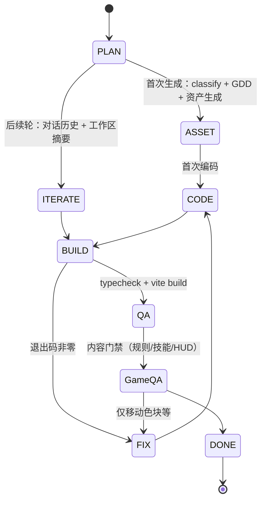
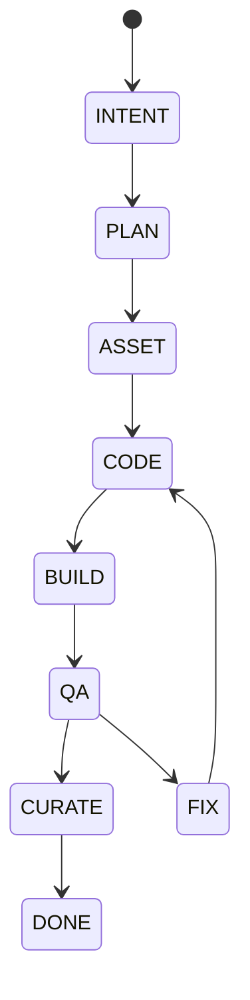

# Agent 编排（PLAN → CODE → BUILD → QA → FIX）

> 适用版本：P0（`apps/platform-worker@0.0.0` 起）。本文档配合 [`runtime-architecture.md`](./runtime-architecture.md) 阅读。

## 1. 目标

把 `generate` Job 从「单次 OpenGame CLI 调用」升级为**有限状态机**，让模型在构建/QA 反馈下自我修复，覆盖「完全无模板派」必然带来的构建失败率上升。

成功率门槛（P0）：从空白生成 Flappy/Snake/2048 三个标杆 ≥ 80%。

## 2. 状态机



实现位于 [`apps/platform-worker/src/processJob.ts`](../../apps/platform-worker/src/processJob.ts) 的 `runGenerateFsm` 及辅助模块：

- [`generationPipeline.ts`](../../apps/platform-worker/src/generationPipeline.ts)：`classify` → `generate-gdd` → **ASSET**（`generate_game_assets`）
- [`conversationHistory.ts`](../../apps/platform-worker/src/conversationHistory.ts) + [`cliSession.ts`](../../apps/platform-worker/src/cliSession.ts)：多轮对话与 CLI `--resume`
- [`promptContracts.ts`](../../apps/platform-worker/src/promptContracts.ts)：`SKELETON_CONTRACT` vs `ITERATION_CONTRACT`
- [`gameQualityGate.ts`](../../apps/platform-worker/src/gameQualityGate.ts)：构建通过后的玩法内容 smoke
- [`assetRegistry.ts`](../../apps/platform-worker/src/assetRegistry.ts)：扫描 `public/assets` 写入 `assets` 表

- 单次 `generate` Job 内最多跑 `MAX_FIX_ITERATIONS = 5` 轮（首轮 + 自愈）。
- 每轮都是「CLI（CODE/ITERATE/FIX）+ validateBuild + Game QA」。
- 后续用户消息默认 **增量迭代**（`ITERATE` phase），并注入 `chat_messages` 历史与工作区 `game.json` 摘要。
- CLI 调用启用 `--chat-recording true` 与 `--resume <cliSessionId>`（映射见 `.opengame/platform-cli-session.json`）。
- 通过 QA 后**直接** 上传 dist、登记 artifact 与 deployment。

## 3. 角色字典

| 角色 (`role`) | 责任 | 当前实现 | P1+ 计划 |
| --- | --- | --- | --- |
| `planner` | classify + GDD | `GameTypeClassifierTool` + `GenerateGDDTool`（Core） | 模板市场联动 |
| `coder` | 写 TS / 完善 game.json | OpenGame CLI（CODE / ITERATE） | 拆 fixer 子 Agent |
| `artist` | 图/音/视频 | 独立 ASSET 阶段 CLI + `assetRegistry` | 用量预算 |
| `qa` | typecheck + build + 内容门禁 | `validateBuild` + `gameQualityGate` | 启动截图比对 |
| `fixer` | 阅读失败日志改代码 | 也是 OpenGame CLI 主进程 | P3 拆出专注 fix 的子 Agent，降低 fix 时的 token 消耗 |
| `system` | 框架/Worker 信号 | Worker 本身 | 不变 |

## 4. 事件总线 `agent_events`

每个状态转移都向 [`agent_events`](../../packages/platform-db/src/schema.ts) 表写一条结构化事件，同步发布到 Redis pub/sub 通道 `job:{projectId}:updates`：

```ts
{
  kind: 'agent-event',
  jobId, projectId, sessionId,
  role: 'planner' | 'coder' | 'artist' | 'qa' | 'fixer' | 'system',
  phase: 'PLAN' | 'CODE' | 'ASSET' | 'BUILD' | 'QA' | 'FIX' | 'DONE' | 'FAIL',
  tool?: string,           // e.g. 'opengame-cli', 'npm run build'
  seq: number,             // 同 role+phase 下的递增序号
  summary?: string,        // 一行人类可读
  details?: object,        // 结构化负载 (exitCode、字符数、cost、artifact id…)
  elapsedMs?: number,
  ts: number,
}
```

BFF SSE 端点把 `kind === 'agent-event'` 的消息转发为 `event: agent-event`（`event: job-update` 仍保留作为旧通道），见 [`apps/platform-api/src/v1.ts`](../../apps/platform-api/src/v1.ts) 的 `/projects/:projectId/events`。

IDE 侧消费见 [`apps/platform-web/src/hooks/useGeneration.ts`](../../apps/platform-web/src/hooks/useGeneration.ts) + [`apps/platform-web/src/components/Agent/AgentTimeline.tsx`](../../apps/platform-web/src/components/Agent/AgentTimeline.tsx)。

## 5. 历史回放

每次重新打开会话时，IDE 调 `GET /v1/projects/:id/jobs/:jobId/agent-events` 拉取该 Job 全部历史事件并按 `createdAt` 升序回放到时间线。

## 6. 失败语义

- **CLI 退出码非零**：进入 FIX，但 Prompt 不带构建日志（因为根本没跑到 build），只附加"上次 CLI 异常"提示。
- **typecheck 失败**：进入 FIX，Prompt 包含 typecheck stderr/stdout 尾段。
- **build 失败**：进入 FIX，Prompt 包含 build stderr/stdout 尾段。
- **3 轮后仍失败**：Job 标记 `failed`，写一条 `phase: 'FAIL'` 事件；前端的 `JobRetryPanel` 仍可手动重试。

## 7. 资源/成本边界（P1 计划）

P0 不限 token，P1 引入 **质量预算**：

- 每 `generate` Job 上限：reasoning ≤ 200K tokens、image ≤ 8 张、video ≤ 20s、audio ≤ 60s。
- 命中上限提前在 PLAN 阶段判定（Planner 自查），超额则降级（如禁用 video、转用更便宜的 image 模型）。
- 上限存储位置：`subscriptions.plan` 决定一组上限，单 Job override 在 `jobs.payload.budget`。

## 8. 测试矩阵

- 单元：[`packages/runtime/src/dsl/schema.test.ts`](../../packages/runtime/src/dsl/schema.test.ts)
- 标杆 PoC：[`packages/runtime/src/poc.test.ts`](../../packages/runtime/src/poc.test.ts)
- 顶层冒烟：[`integration-tests/runtime-poc.test.ts`](../../integration-tests/runtime-poc.test.ts)
- Worker FSM：在 P0 末通过实际跑「`generate` Job → SSE 收到全部 5 个 phase 事件」串通验收（手动 + scripted）。

## 9. 与现有文档的兼容性

- 不改 [`docs/platform/opengame-minimax-one-stop.md`](./opengame-minimax-one-stop.md) 的"模态能力一律走 Core"原则：所有 `artist` 角色调用仍走 OpenGame Core，本编排只负责发起与结果回收。
- 不改 [`docs/platform/strategic-roadmap-and-gaps.md`](./strategic-roadmap-and-gaps.md) 的"诚实失败"哲学：3 轮失败就 `failed`，不发占位 deployment。

## 10. Agent 智能层（Brief / Memory / RAG / Curator）

在 P0 流水线之上，Worker 在 `generate` Job 开始时增加 **INTENT** 阶段，结束时增加 **CURATE** 阶段：



### 10.1 分层上下文（Context Stack L0–L5）

| 层级 | 内容 | 模块 |
| --- | --- | --- |
| L0 | 契约（ITERATION / SKELETON） | `promptContracts.ts` |
| L1 | RAG 检索片段 | `@opengame/platform-rag` |
| L2 | ProjectBrief + MemoryFacts | `@opengame/platform-agent` |
| L3 | SessionSummary + 最近 3 轮 | `sessionSummary.ts` |
| L4 | 工作区 game.json 摘要 | `workspaceContext.ts` |
| L5 | 用户本轮 + Delta | `intentService.ts` |

组装器：[`packages/platform-agent/src/contextStack.ts`](../../packages/platform-agent/src/contextStack.ts)，Worker 入口 [`agentContext.ts`](../../apps/platform-worker/src/agentContext.ts)。

预算环境变量：`PLATFORM_CONTEXT_BUDGET`（JSON，含 `maxTotalChars` / `maxRagChars` / `recentTurnsFull`）。

### 10.2 记忆与简报

- DB 表：`project_briefs`、`project_memories`、`chat_sessions.summary`（migration `0006_agent_intelligence.sql`）
- 工作区同步：`GAME_BRIEF.json`
- API：`GET/PATCH /projects/:id/brief`、`GET /projects/:id/memories`、`GET /projects/:id/session-context`
- IDE：[`GameContextWindow`](../../apps/platform-web/src/components/Generation/GameContextWindow.tsx) 展示真实 Summary / Brief / 记忆

### 10.3 RAG

- **R1**：关键词 + archetype 过滤，直读 `agent-test/docs` 与 PoC（默认）
- **R2**：`rag_document_chunks` 表 + 可选 embedding 余弦（`PLATFORM_RAG_USE_DB=true`）
- **社区模板**：发布到社区时 ingest 到 `community_templates` 集合；`GET /community/rag-suggestions?q=` 供模板市场搜索联动

### 10.4 上下文压缩

- 平台侧：`compressContextIfOverBudget` 在 Context Stack 超限时裁剪
- CLI 侧：Worker 写入工作区 `.qwen/settings.json` 的 `chatCompression.contextPercentageThreshold`（默认 70%，可用 `PLATFORM_CHAT_COMPRESSION_THRESHOLD` 覆盖）

### 10.5 Curator 与用户反馈

- Job 成功后 `runCuratorPass` 更新 Brief、SessionSummary、项目记忆
- `POST /projects/:id/jobs/:jobId/feedback`：低分评论写入负向记忆
- IDE：[`JobFeedbackPanel`](../../apps/platform-web/src/components/Generation/JobFeedbackPanel.tsx)、[`AgentQualityPanel`](../../apps/platform-web/src/components/Generation/AgentQualityPanel.tsx)
- 迭代历史展示 `contentHash`：[`IterationHistory`](../../apps/platform-web/src/components/Conversation/IterationHistory.tsx)
