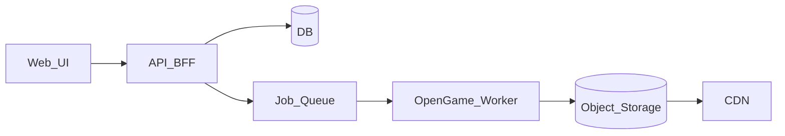

# 商业化：对话生成游戏 + 在线托管（MVP 架构说明）

OpenGame 仓库本体是 **CLI / headless Agent + 核心库**，适合作为 **「生成 Worker」**；多租户 SaaS 需要在之上增加平台层。以下为与现有代码边界清晰的 **MVP** 建议。

## 1. 目标能力

- 用户在 Web 端多轮对话，创建/迭代「游戏项目」。
- 后台异步执行 OpenGame（headless），将产物写入对象存储。
- 构建静态站点（如 Vite `npm run build` 输出）并经由 CDN 提供 HTTPS 访问。
- 按用户/订阅做 **配额与队列**（与供应商速率限制对齐，例如 MiniMax [速率限制](https://platform.minimaxi.com/docs/guides/rate-limits.md) 与订阅档位下的日配额）。

## 2. 逻辑架构

- **API + DB**：用户、项目、会话、Job 状态、用量计数。
- **Queue**：削峰；与 MiniMax 图片/视频日配额联动（超限则延迟或降级为无动画方案）。
- **Worker**：容器内已安装 Node 与依赖；调用 `opengame` headless；**禁止默认开启 shell yolo**，仅白名单构建命令或专用沙箱镜像。
- **托管**：每个 Job 产出 `dist/` 或约定目录，上传后生成预览 URL；生产环境绑定自定义域名与证书。

## 3. 密钥与计费

- **平台统一出账**：Worker 使用平台托管的 MiniMax Key（KMS），勿将终端用户 Key 明文写入生成容器。
- **成本归因**：Job 维度记录 image 张数、视频条数、chat tokens，便于对齐全模态账单。

## 4. 合规与风控

- UGC 提示词与生成素材的审核策略（版权、暴力、品牌等）。
- 生成物许可证与用户协议（谁拥有生成代码/素材的权利）。

## 5. 与 OpenGame 的衔接点

- **Worker 环境清单**（目录、`OPENGAME_*`、对象存储变量）：见 [worker-environment.md](./worker-environment.md)。
- **本地平台栈**（Docker Compose + `platform:dev`）：见 [hosted-deployment.md](./hosted-deployment.md)。
- 入口：与 README 一致使用 headless 提示 + 自动 `auto-edit` 策略；平台层注入 `GAME_TEMPLATES_DIR` / `GAME_DOCS_DIR`。
- 模型：四模态 `OPENGAME_*_PROVIDER=minimax` + 主 Agent `OPENAI_*` 或 `ANTHROPIC_*` 指向 MiniMax（见 [minimax.md](../users/configuration/minimax.md)）。

## 6. MVP 交付顺序建议

1. 单租户跑通：API 触发一次生成 → 静态预览链接。
2. 队列 + 失败重试 + 日志可观测（结构化日志 / trace id）。
3. 多租户与配额；构建缓存（依赖安装缓存、模板只读层）。
4. 计费与套餐；可选企业独立密钥池。
