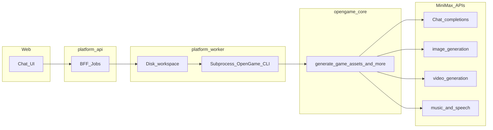

# 托管平台 + OpenGame + MiniMax：一站式架构说明

本文说明 **平台层如何严格基于当前 OpenGame 仓库扩展**，以及如何利用内置 **MiniMax 全模态**（文 / 图 / 视频 / 音乐与语音）让用户在 Web 侧发起的一条消息，最终在 **同一套 `packages/core` 工具链** 中完成游戏生成与构建。

## 1. 原则：平台不复制模型逻辑

| 层级 | 职责 | 代码位置 |
|------|------|----------|
| **OpenGame Core** | GDD、分类、`generate_game_assets`（图/动/音/瓦片）、Tilemap、provider 解析（含 `minimax`） | [`packages/core/src`](../../packages/core/src) |
| **OpenGame CLI** | 主 Agent 循环、工具执行、headless `--prompt` | [`packages/cli`](../../packages/cli) |
| **平台 Worker** | 磁盘工作区、子进程调用 **已构建的 `dist/cli.js`**、日志与 `dist/` 上云、队列编排 | [`apps/platform-worker`](../../apps/platform-worker) |
| **平台 API / Web** | 会话、项目、Job、预览 URL、配额 | [`apps/platform-api`](../../apps/platform-api)、[`apps/platform-web`](../../apps/platform-web) |

**禁止偏离**：不在 Worker 内重新实现文生图 / 视频轮询等业务 HTTP；这些逻辑 **必须** 留在 Core 的 `MinimaxImageService`、`assetVideoService`、`minimaxMusicSpeech` 等模块中，由 **OpenGame 子进程** 在生成任务里自然调用。

## 2. 数据流（用户一站式）

用户在 Web 输入自然语言后，`generate` Job 在 **`PLATFORM_WORK_ROOT/projects/{id}/repo`** 中运行与本地开发相同的 OpenGame；**`OPENGAME_*` 与 `OPENAI_*` 环境变量** 由你在 Worker 进程上注入（与 [minimax.md](../users/configuration/minimax.md) 一致），因此 **图文音视频** 能力取决于你为四模态与主 Agent 配置的 provider（全选 `minimax` 即全模态走 MiniMax）。

## 3. 可选：生成前 Provider 预检

Worker 支持：

`PLATFORM_OPENGAME_PROVIDER_PREFLIGHT`

- `off`（默认）：不预检（与本地 CLI 行为一致，首次缺 Key 时在工具内报错）。
- `all`：对 `reasoning` / `image` / `video` / `audio` 调用与 Core 相同的 [`resolveProviderConfig`](../../packages/core/src/services/providerConfig.ts)，**提前**抛出与 CLI 一致的可读错误。
- `minimax`：仅对 **`OPENGAME_<MOD>_PROVIDER=minimax`** 的模态做解析，便于「全 MiniMax」部署快速验收。

实现见 [`apps/platform-worker/src/openGameProviderPreflight.ts`](../../apps/platform-worker/src/openGameProviderPreflight.ts)。

## 4. 与产品文档的关系

- 功能矩阵与路线图：[product-design.md](./product-design.md)
- Worker 环境变量清单：[worker-environment.md](./worker-environment.md)
- MiniMax 变量与 API 对照：[minimax.md](../users/configuration/minimax.md)
