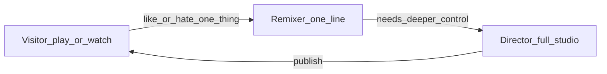

# OpenGame 托管平台：产品化设计（双环：玩 → 改一句 → 再发布）

目标：在 **不依赖计费/订阅** 的前提下提供可自托管的 **完整产品**。产物不是一次性下载包——发布出来的游戏能被别人直接玩，发布出来的世界会继续过日子。

## 0. 定位

**一句话**：这不是又一个「描述一下就出游戏」的工具站，而是一座 **活的游戏台**：有人在玩别人做好的游戏，有人在围观还在过日子的小镇；玩腻了或看不顺眼，改一句再发布。

和常见形态的差别：

- 对 AI 生成器：产物可玩、世界会继续走，不是导出即结束。
- 对 UGC 平台：不拼创作者经济，拼「一句话改建 + 社会还在过」。
- 对短视频：不拼刷，拼 **今晚这座镇发生了什么**。

硬核生成仍是护城河，但 **不是唯一玩法**：生成慢且贵，粘性来自「再玩一局别人的游戏 / 再看一眼这座镇 / 改一个字」。

## 1. 三种人，一条漏斗

- **访客**：不生成，只玩 / 围观。首页应是社区，不是空白工作室；未登录即可玩、可看。进别人的世界先看见今夜题，登录后才能压盘（见 [world-betting.md](./world-betting.md)）。
- **改口人**：在别人的作品上改一句（「把铁匠改成叛徒」），走 `POST /v1/community/games/:slugOrId/fork` + 游戏 follow-up 或 `world_edit`。世界页上这是次入口，不是第一眼。
- **导演**：完整工作室（`apps/platform-web/src/pages/GeneratePage.tsx`），世界创建引导（美术 / 社会规模 / 开场已过时长）在这里。发布即开盘，作者只选题面、吃抽成，不能压自己的镇。

## 2. 导航话术（社区=去玩，工作室=去生成）

| 位置 | 话术 | 落点 |
|------|------|------|
| 访客访问 `/` | 直接进社区（无深链参数时） | `/community` |
| 工作室右上 | **去玩** | `/community` |
| 社区右上 | **去生成** / 未登录显示 **登录** | `/`（工作室，未登录先登录再回来） |
| 社区分栏 | **可玩的游戏** / **可观察的世界** | `category != world` / `category = world` |
| 世界详情主操作 | **看今夜题并下注** | 盘面 `GET/POST .../course` + `.../course/stake`；地图 `?mode=observe` |
| 世界详情次入口 | **说一句**（免费耳语）| `POST /v1/community/games/:id/whisper`（不挂价） |
| 详情页再次按钮 | **改一句变成我的** | fork → 预填提示词进工作室（世界页下沉，不当第一眼） |

登录页不写「开发者邮箱 / Dev Token」这类口吻：面向的是玩家与作者，不是接入方。

## 3. 用户旅程

1. **进社区**：未登录访问 `/` 直接落到社区（带深链参数时仍进工作室）；可浏览、可玩、可进世界看今夜题。点收藏 / 评论 / 改一句 / 留耳语 / 压盘 / 上报分数才要求登录，并在登录后回到原来那句话。世界轨只卖下注，对白配额不进访客 UI，见 [world-betting.md](./world-betting.md)。
2. **登录**：**登录链接**（`POST /v1/auth/magic/request` → `POST /v1/auth/magic/verify`，链接 15 分钟有效且只能用一次；配置 `PLATFORM_MAIL_PROVIDER` 后走邮件投递，否则按 `PLATFORM_MAGIC_LINK_ECHO` 回显或只写服务端日志）或邮箱直登（`POST /v1/auth/dev-token`，需 `PLATFORM_ALLOW_DEV_AUTH`）。首次登录自动建 Personal 组织（配额账本，对玩家隐藏），并按邮箱前缀占一个 `handle`。
3. **身份**：`handle` / 昵称 / 头像 / 简介写在 `users`；公开主页 `/u/:handle`；私有作品库 `/profile`。
4. **改一句（轻创作环）**：详情页选 remix 芯片或自己写一句 → fork 出项目（世界会连 Spec 一起复制）→ 带预填提示词进工作室 → 发布回社区。
5. **完整生成（导演环）**：对话写入 `chat_messages` 并入队 `generate` / `world_generate` Job。
6. **生成（真实）**：Worker 在项目工作区以子进程运行 OpenGame CLI，日志上传 S3；成功后自动入队 `build`。
7. **构建（真实）**：同一工作区执行 `npm ci` + `npm run build`，`dist/` 全量上传 S3，创建 preview `deployment`。
8. **发布**：`POST /v1/community/games/publish` 落 `community_games`；发布成功后主按钮进 **作品页**（复制链接 + 邀请改一句），不是丢回无差别列表。
9. **围观者留一句**：登录后可对别人的镇说一句（`POST /v1/community/games/:id/whisper`），走的是作者用的同一条 live whisper 通道——居民真的会有反应，公开留言簿显示是谁说的。限流：同一人对同一座镇 20 秒一句、每天 12 句。
10. **回来的理由**：关注的世界在 `/profile` 与手机「在玩」显示「又过了几天」（当前 sim 时间 vs 上次看到的 sim 时间）；满一天即可转发海报。点进观察台即视为看过，摘要归零。

## 4. 功能矩阵（与实现对齐）

| 功能 | 状态 | 说明 |
|------|------|------|
| 项目 CRUD | 已实现 | `/v1/projects` |
| 多轮消息 + 生成 / 构建 / 预览 | 已实现 | 依赖 `PLATFORM_OPENGAME_CLI`、`PLATFORM_WORK_ROOT` |
| 世界生成 / 观察台 / 耳语 | 已实现 | `world_generate`、`world_edit`、society tick |
| 世界创建引导（美术 / 规模 / 开场时长） | 已实现 | `WorldCreateGuide` → `gameParams` → planner |
| 社区发布 / 游玩 / 评分 / 评论 / 排行榜 | 已实现 | `community_games` + `game_*` 表；排行榜在游戏详情侧栏，上报分数需登录 |
| 围观者耳语（公开留言簿） | 已实现 | `world_whispers` + `POST /community/games/:id/whisper`（限流 20s / 12 条每天；世界页不挂价） |
| 世界下注（走向盘） | 已实现 | 访客只压 12/24/48；发布即开盘；正文 [world-betting.md](./world-betting.md) |
| 社区分栏（游戏 / 世界） | 已实现 | 世界卡显示 sim 天数与是否还在过日子 |
| 未登录游玩 | 已实现 | `GET /v1/public/games/:slugOrId/play-url`（签名预览代理，无需 CDN） |
| Remix（改一句 → fork → 预填工作室） | 已实现 | fork 复制 world spec；`/?project=…&remix=…` |
| 收藏 / 关注世界 + 再访摘要 | 已实现 | `user_followed_games`（含 `last_seen_sim_time`） |
| 用户资料 / 公开主页 / 作品库 | 已实现 | `users.handle` 等 + `/u/:handle` + `/profile` |
| 游玩历史 | 已实现 | `user_play_history`（详情页上报） |
| 登录链接（Magic Link） | 已实现 | 签名短效 token + Redis 一次性核销；`PLATFORM_MAIL_PROVIDER` 配了就发邮件，没配则按 `PLATFORM_MAGIC_LINK_ECHO` 回链接或只写服务端日志 |
| 邮件投递 | 已实现（可选） | `resend` 或自建 `http` 端点，一个 `fetch`，不引 SMTP 依赖；投递失败自动回落到回显 / 日志 |
| 配额可见 | 已实现 | `/profile` 读 `GET /v1/billing/quota` |
| 今晚这座镇（活动流） | 已实现 | `GET /community/worlds/activity`；世界分栏顶部；作品页展示最近一句 |
| Remix 溯源 | 已实现 | 作品页「改自」链到父作品 |
| 发布落到作品页 | 已实现 | 发布成功主按钮进 `/community/game/:slug`（同页跳转，不再只开新标签） |
| 评论 / 评分登录回跳 | 已实现 | 与 remix / 耳语同一套 `loginIntent` |
| 内嵌观察视为已看过 | 已实现 | iframe 打开即 `markSeen`，不只是新窗口 |
| iframe 计分上报 | 已实现 | 运行时 `postMessage` + 作品页代交；URL 带 `ogGameId` |
| 付费页 / Stripe Checkout | 未实现 | Webhook 与订阅表已在，前端不做 |
| OAuth（GitHub / 微信） | 未实现 | 登录页不放假入口 |
| 运营开关（精选） | 已实现（最简） | `PLATFORM_ADMIN_EMAILS` 白名单 + `PATCH /community/games/:id/featured`，详情页按钮；不做完整后台 |
| Bench | 条件真实 | 必须配置 `PLATFORM_BENCH_COMMAND`，否则 Job 失败而不是给假分 |

## 5. 技术约束（自托管）

- **单机工作区**：同项目的生成 / 构建在同机 `PLATFORM_WORK_ROOT` 串行；横向扩展需工作区快照或分布式锁。
- **Worker 与仓库路径**：`PLATFORM_OPENGAME_CLI` 必须指向已 `npm run build` 的 `dist/cli.js`。
- **网络与密钥**：Worker 需能访问模型 API，与 [worker-environment.md](./worker-environment.md) 一致。
- **数据库迁移**：`packages/platform-db/migrations/*.sql` 按字典序幂等执行，无版本表，新增迁移必须 `IF NOT EXISTS` 可重跑。

## 6. 与 OpenGame + MiniMax 的对齐（全模态）

平台 **不实现** 模型 HTTP 适配器；**一律**通过子进程 OpenGame 调用现有 Core（含 `minimax` 的 reasoning / image / video / audio）。架构说明见 [opengame-minimax-one-stop.md](./opengame-minimax-one-stop.md)。

## 7. 原则

- 不重做生成管线，不把社区做成第二个 CMS。
- 每次迭代要么让 **没点过生成的人** 多留一分钟，要么让 **生成完的人** 多回来一次。
- 世界与游戏都是一等公民；世界不是 `category` 里的一个筛选项而已。
- 更完整的缺口矩阵见 [strategic-roadmap-and-gaps.md](./strategic-roadmap-and-gaps.md)。

## 8. P5 已闭环的生态玩法，P6 仍后置

P0–P4 把身份、社区主场、改一句、再访摘要做通之后，社区仍会漏几拍：发布完人不在作品页、评论 401、排行榜是手填的、世界 tab 看不到「今晚发生了什么」。P5 专门补这些漏环，仍然不碰 OAuth / Stripe / 好友图谱。

已落地：

1. **今晚这座镇**：公开活动流，只取可读的对话 / 耳语 / 传闻，同一座镇最多两条，避免一个热闹世界占满首页。
2. **改一句溯源**：fork 出去的作品页写明改自哪一件，双环在发布之后仍看得见。
3. **发布回流**：作者点「打开作品页」是站内跳转，停在可以复制链接、邀请改一句的地方。
4. **社交登录回跳**：评论、评分、iframe 分数都记住要做的那件事，登录后自动补上。
5. **围观即已看过**：内嵌观察台打开就算追上 sim 时钟，关注列表里的「又过了几天」会归零。
6. **游玩计分**：运行时把分数 `postMessage` 给作品页，由已登录的父页代交；预览 URL 带 `ogGameId`。已经发布的旧包如果没用新 runtime，侧栏仍可手填分数。

P6 以后再说（明确不做本期）：OAuth、Stripe Checkout 页、完整运营后台、关注人、评论盖楼、道具经济、每日任务数值。

